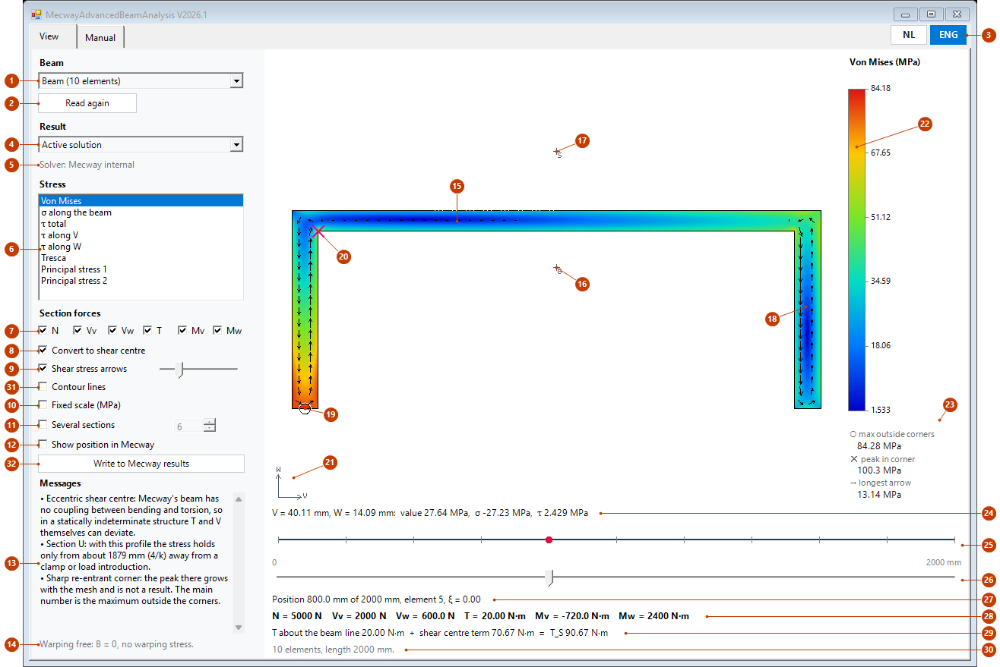

# MecwayAdvancedBeamAnalysis

The stress at every point of a beam section in [Mecway](https://mecway.com), at any position along a straight beam, in a
window of its own.

Solve a beam model, select the beam, start the script. The window shows σ, τ, von Mises, Tresca and the principal stresses in
colour over the real shape of the section, with the shear stress as arrows. A slider moves the section along the beam; twelve
sections fit side by side on one colour scale. Each of the six section forces can be turned on and off.
The same sections also stand in a 3D view at their place along the beam, and a double click opens one of them in detail.

The tool calculates the stress itself from the section forces, with the finite element formulation of Pilkey on a mesh of the
section, in Python with numpy and scipy. It works with Mecway's own solver, with CCX and with Code-Aster through
[MecwayAsterBridge](https://github.com/trednuK/MecwayAsterBridge); Mystran gives σ only. The theory is linear elastic, with free
warping, for a straight prismatic beam.

## Requirements

- Mecway 35 (Windows), with its scripting (IronPython 2.7.9) and Windows Forms. Mecway 34 was not tested.
- Python 3 with numpy and scipy (scipy 1.3 or newer). This is a prerequisite: Python is not included. The Python of a Code-Aster
  installation is found automatically; so is another Python with these packages.
- [MecwaySectionProps](https://github.com/trednuK/MecwaySectionProps) V2026.4 or newer, only for general sections: it stores
  their shape in the model.
- Optional: MecwayAsterBridge V2026.9 or newer, for Code-Aster solutions, also for `POU_D_TG` and for the bridge's own
  stresses over the beam sections as Mecway results of a Code-Aster run.

## Installation

1. Download the [latest release](https://github.com/trednuK/MecwayAdvancedBeamAnalysis/releases/latest) (*Source code (zip)*,
   unzip) or clone this repository, e.g. to `Documents\GitHub\MecwayAdvancedBeamAnalysis`.
2. In Mecway: *Tools* > *Scripts...* > *New*, and choose `Scripts\MecwayAdvancedBeamAnalysis.py`. It then appears in the *Tools*
   menu.

## Use

1. Add the field variables `tensile force`, `shear force`, `torsion moment` and `bending moment 2` to the model, solve and save.
2. Select the beam elements, or make a named selection.
3. *Tools* > *MecwayAdvancedBeamAnalysis*. The window stays open next to Mecway.

Full documentation: [English](docs/en/MecwayAdvancedBeamAnalysis.md), [Nederlands](docs/MecwayAdvancedBeamAnalysis.md).

## Accuracy

Checked against own solid models in Code-Aster on five sections, with the section forces taken from the solid model: σ within
0.18 %, τ within 3.82 %, measured as largest deviation over the peak, outside the corner zones. On open sections this holds only
at max(5h, 4/k) or more from a clamped end or load introduction. Details in the documentation, §7.

## Development

- `Scripts/`: `MecwayAdvancedBeamAnalysis.py` (entry point), `beam_gui.py`, `beam_mecway.py` (IronPython 2.7, inside Mecway);
  `beam_utils.py` (both); `beam_worker.py`, `beam_model.py`, `beam_render.py`, `section_stress.py`, `section_profiles.py`,
  `section_mesh.py`, `section_fem.py` (Python 3 with numpy and scipy, started as a process).
- Tests: see [AGENTS.md](AGENTS.md). The images: `tools/gui_cap.py` and `tools/make_figures.py`.
- Conventions: [AGENTS.md](AGENTS.md).

## License

[Mozilla Public License 2.0](LICENSE). Mecway is a product of Mecway Ltd; this project is not affiliated with Mecway Ltd or EDF
(Code-Aster).
