# MecwayAdvancedBeamAnalysis: spanningen op elk punt van een balkdoorsnede

*English version: [MecwayAdvancedBeamAnalysis.md](en/MecwayAdvancedBeamAnalysis.md)*

MecwayAdvancedBeamAnalysis is een eigen venster in Mecway. Het toont de spanning op elk punt van een
balkdoorsnede, op elke plaats langs een rechte balk. Mecway's balk geeft snedekrachten en een paar
spanningspunten. Deze tool rekent daaruit het hele veld uit: σ, τ en von Mises in kleur, de schuifspanning
als pijlen.

| De tool doet | De tool doet niet |
|---|---|
| Spanning uit de zes snedekrachten en de vorm van de doorsnede | Zelf de constructie oplossen |
| Elke doorsnede: standaardprofielen en algemene doorsneden met een vorm | Doorsneden uit losse delen: daar alleen σ |
| Wringing om het schuifcentrum, ook bij U- en L-profielen | Verhinderde welving: geen bimoment, geen welvingsspanning |
| Verdeelde last en zwaartekracht binnen een element herstellen | Plasticiteit, grote rotaties, knik |
| Schuifbalk langs de balk, of tot twaalf doorsneden naast elkaar of in 3D op hun plaats | Gekromde of taps toelopende balken |

De theorie is lineair elastisch, met vrije welving, voor een rechte prismatische balk (Saint-Venant).

**Inhoud:** [1. Installatie](#1-installatie) · [2. Gebruik](#2-gebruik) · [3. Het venster](#3-het-venster) · [4. Assen en snedekrachten](#4-assen-en-snedekrachten) · [5. Hoe de spanning wordt berekend](#5-hoe-de-spanning-wordt-berekend) · [6. Hoe het werkt](#6-hoe-het-werkt) · [7. Nauwkeurigheid](#7-nauwkeurigheid) · [8. Beperkingen](#8-beperkingen) · [9. Meldingen](#9-meldingen) · [10. Bronnen](#10-bronnen)

## 1. Installatie

Nodig:

- **Mecway 35**. Daarop is alles getest. Mecway 34 is niet getest.
- **Python 3 met numpy en scipy** (scipy 1.3 of nieuwer). Python zit er niet bij. Staat Code-Aster op de
  pc, dan wordt die Python gebruikt en hoef je niets te installeren. Anders zoekt de tool in het `PATH` en
  in de standaardmappen. Ontbreken numpy of scipy, dan noemt het venster het commando:

  ```bash
  python -m pip install numpy scipy
  ```

- **MecwaySectionProps** V2026.4 of nieuwer, alleen voor een algemene doorsnede. Het schrijft de vorm als `SECTIE-VORM` in het
  model. Standaardprofielen (rechthoek, cirkel, buis, I, T, L, C) hebben dat niet nodig.
- **MecwayAsterBridge** V2026.9 of nieuwer, optioneel, voor oplossingen van Code-Aster, ook voor `POU_D_TG` en voor de
  eigen spanningen van de bridge over de balkdoorsneden als Mecway-resultaten van een Code-Aster-run.

Stappen:

1. Download de [laatste release](https://github.com/trednuK/MecwayAdvancedBeamAnalysis/releases/latest)
   (*Source code (zip)*, uitpakken) of kloon deze repository, bijvoorbeeld naar
   `Documents\GitHub\MecwayAdvancedBeamAnalysis`.
2. Voeg het script toe aan Mecway: *Tools* > *Scripts...* > *New*, en kies
   `Scripts\MecwayAdvancedBeamAnalysis.py`. Het script staat daarna in het menu *Tools*.

Instellingen zijn normaal niet nodig. Ze staan in `WorkDir\beam_settings.json`, naast de map `Scripts`:

| Sleutel | Betekenis | Standaard |
|---|---|---|
| `language` | `nl` of `en` (de knoppen NL en ENG in het venster) | de taal van Windows |
| `python` | pad van een `python.exe` met numpy en scipy | gezocht: Code-Aster, `PATH`, standaardmappen |
| `python_found` | de Python die de zoektocht vond (schrijft de tool zelf) | - |
| `contours` | contourlijnen aan of uit (schrijft de tool zelf) | uit |
| `sheet_view` | `2d` of `3d` bij meerdere doorsneden (schrijft de tool zelf) | `2d` |

De logboeken `beam_log.txt` en `beam_worker_log.txt` staan in dezelfde map.

## 2. Gebruik

1. **Maak het balkmodel**, met line2-elementen en een doorsnede. Geef de balken de juiste *Element
   orientation*.
2. **Voeg vier veldvariabelen toe vóór het oplossen:** `tensile force`, `shear force`, `torsion moment` en
   `bending moment 2`. Klik daarvoor met de rechtermuisknop op *Solution* in de boom, of open het menu
   *Solution*, en kies ze. Zo staat het in Mecway's handleiding. De exacte menu-items zijn voor deze tool
   niet nagelopen; gemeten zijn de regels in het `.liml`-bestand:

   ```xml
   <fieldvariable name="tensile force" displayunit="N" />
   <fieldvariable name="shear force" displayunit="N" />
   <fieldvariable name="torsion moment" displayunit="N.m" />
   <fieldvariable name="bending moment 2" displayunit="N.m" />
   ```

   Mecway bewaart alleen wat hier staat (gemeten op Mecway 35). De tool schrijft deze regels nooit zelf,
   want een verkeerde naam geeft in Mecway een melding die wacht op een klik. Zonder deze variabelen krijg je
   alleen σ, uit de verplaatsingen en rotaties.
3. **Los het model op.** Voeg je de variabelen later toe, los dan opnieuw op.
4. **Sla het model op.** Oriëntatie, materialen, `SECTIE-VORM` en lasten staan alleen in het bestand; de API
   geeft ze niet. Het venster vergelijkt bestand en model (aantallen en coördinaten) en vraagt om op te slaan
   als ze verschillen.
5. **Selecteer de balkelementen** in Mecway, of maak een benoemde selectie. Element- en face-selecties
   werken allebei. De elementen moeten één doorlopende lijn vormen. Een knik mag: elke doorsnede rekent in
   het eigen element, met een melding. Een benoemde elementselectie die je na het laatste opslaan maakt of
   hernoemt, staat in de lijst als *nog niet opgeslagen* en opent pas na opslaan en **Opnieuw lezen**: de
   API geeft voor een knoop- en een elementselectie dezelfde nummers (gemeten), alleen het bestand zegt welke
   het is. Een face-selectie herkent het venster ook zonder bestand.
6. **Start** *Tools* > `MecwayAdvancedBeamAnalysis`. Het venster blijft naast Mecway open. Python starten
   duurt de eerste keer ongeveer 2 s. Nog een keer starten haalt het open venster naar voren.
7. **Kies Balk en Resultaat** (nummers 1 en 4 in §3). Na een nieuwe selectie, een nieuwe oplossing of opslaan
   kies je **Opnieuw lezen**.

## 3. Het venster

Het venster heeft twee tabbladen: *Weergave* met de doorsneden (§3.1 tot §3.3) en *Handleiding* met deze tekst
(§3.4).

### 3.1 Eén doorsnede

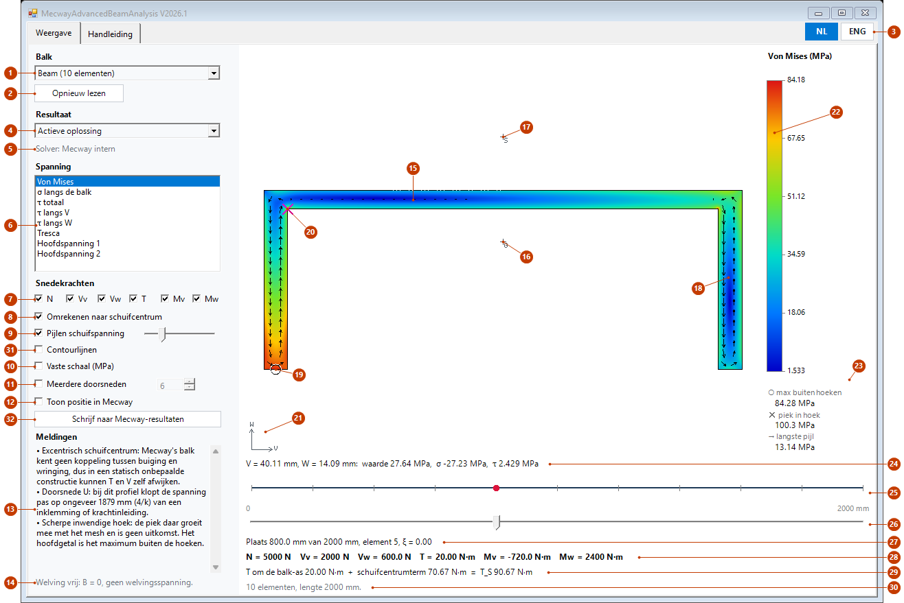

*Eigen voorbeeld, geen meting: een cantilever van 2 m met een U-profiel 160 × 60 mm. De krachten komen uit
een nagemaakte oplossing; het rekenproces is het echte. Op dit korte open profiel is 4/k bijna de hele balk,
zie `warping_zone` in §7.*

| Nr | Onderdeel | Wat het doet |
|---|---|---|
| 1 | Balk | Kies *Huidige selectie* of een benoemde selectie. Tussen haakjes het aantal balkelementen, of *nog niet opgeslagen* bij een selectie die nog niet in het bestand staat (`selection_unsaved`, §9), of *bestand niet te lezen* (`selection_unreadable`). |
| 2 | Opnieuw lezen | Leest selecties, oplossing en bestand opnieuw. |
| 3 | NL / ENG | Kiest Nederlands of Engels, voor alle teksten en de handleiding. De gekozen taal is blauw gevuld en blijft bewaard. De knoppen staan rechts boven, op beide tabbladen. |
| 4 | Resultaat | *Actieve oplossing*, of een stap, mode of knikmode. Heeft het model configuraties, dan staat elke keuze er per configuratie, bijvoorbeeld *Configuratie A, Stap 1*, ook bij één configuratie. De tool zet die configuratie dan zelf actief in Mecway, ook bij het openen van het venster, en meldt dat. |
| 5 | Solver | De solver volgens het opgeslagen bestand. |
| 6 | Spanning | De maat in kleur: von Mises, σ langs de balk, τ totaal, τ langs V, τ langs W, Tresca, hoofdspanning 1 en 2. Formules in §5.4. Zonder snedekrachten blijft alleen σ over. |
| 7 | Snedekrachten | Zet N, Vv, Vw, T, Mv en Mw los aan en uit. Het beeld volgt direct. Een uitgezette kracht staat tussen haakjes op regel 28. |
| 8 | Omrekenen naar schuifcentrum | Aan: de tool rekent met T_S (§5.3). Uit: met T zoals de solver hem geeft. Laat dit aan, tenzij T al om het schuifcentrum gaat. |
| 9 | Pijlen schuifspanning | Toont τ als pijlen. De schuifbalk ernaast regelt de lengte. |
| 10 | Vaste schaal | Vaste kleurschaal in MPa, van en tot, per spanningsmaat. Handig om plaatsen te vergelijken. |
| 11 | Meerdere doorsneden | Zie §3.2 en §3.3. Het getal is het aantal, 2 tot 12. |
| 12 | Toon positie in Mecway | Zet een tijdelijk element op de plaats van de schuifbalk. Mecway schakelt dan naar het modelbeeld, want in het oplossingsbeeld is zo'n element niet zichtbaar (gemeten). Zet dit uit vóór het oplossen. Bij sluiten ruimt de tool het op. Standaard staat het uit. **Let op Undo (gemeten):** wijzig je in Mecway iets terwijl dit aan staat, of druk je dan op Undo, dan zet Undo of Redo het tijdelijke element later terug in het model, ook na sluiten van het venster. Zet dit dus uit vóór je iets anders wijzigt. Een teruggekomen element verdwijnt bij de volgende start van het venster, of verwijder zelf de component waarvan de naam begint met `Balkpositie_tijdelijk`. |
| 13 | Meldingen | Alles wat je moet weten over dit beeld. Alle teksten staan in §9. |
| 14 | Welving | Herinnering: de welving is vrij, dus er is geen welvingsspanning. Bij een Code-Aster-oplossing staat er dat het bimoment niet is meegerekend. |
| 15 | Het kleurenbeeld | De doorsnede op de plaats van de schuifbalk. Muiswiel zoomt, slepen schuift als je bent ingezoomd, dubbelklik past het beeld weer in. |
| 16 | G | Zwaartepunt, de balk-as. |
| 17 | S | Schuifcentrum. Bij dit U-profiel ligt het buiten de doorsnede. |
| 18 | Pijlen | Schuifspanning op een regelmatig raster. |
| 19 | ○ | Grootste waarde buiten de hoekzones. Dit is het hoofdgetal (§5.5). |
| 20 | ✕ | Piek in een scherpe inwendige hoek. Dit is geen uitkomst (§5.5). |
| 21 | Assen | V naar rechts, W omhoog. Je kijkt tegen U in (§4). |
| 22 | Kleurschaal | Loopt standaard van de laagste tot de hoogste waarde buiten de hoekzones. Liggen er waarden buiten de schaal, zoals een piek in een hoek of bij een vaste schaal, dan staat er *▲ hoger bestaat* of *▼ lager bestaat* bij. |
| 23 | Getallen | Maximum buiten de hoeken, piek in de hoek en de langste pijl. |
| 24 | Onder de muis | V, W, de gekozen waarde, σ en τ op het punt onder de muis. |
| 25 | Zijaanzicht | De balk met elementgrenzen. De rode stip is de plaats. |
| 26 | Schuifbalk | De plaats langs de balk. Werkt met muis, toetsen en wiel. |
| 27 | Plaats | Booglengte, element en ξ (0 tot 1 binnen het element). Op een knoop telt het element erna. |
| 28 | Snedekrachten | De zes krachten op deze plaats, in de assen van de tekening (§4). |
| 29 | Wringmoment | T om de balk-as, de term van het schuifcentrum en T_S. |
| 30 | Status | Wat de tool doet of net deed. |
| 31 | Contourlijnen | Dunne lijnen op de getallen van de kleurschaal, ook bij een vaste schaal en bij meerdere doorsneden. De lijn is wit op donkerblauw en zwart op de andere kleuren. Alles boven de bovenste waarde is één klasse, dus een piek in een hoek geeft geen bos lijnen. Tijdens zoomen en vergroten verschijnen ze pas in het scherpe beeld. De keuze blijft bewaard. |
| 32 | Schrijf naar Mecway-resultaten | Schrijft per knoop van de gekozen balk de grootste waarden buiten de hoeken (zonder ruimte buiten de hoekzones: de grootste overall) in het gekozen resultaat, als knoopvariabelen `sectionvonmises`, `sectionsigma` en `sectiontau`, in Pa. Op andere knopen komt 0. De overige resultaten en de andere stappen of modes blijven zoals ze zijn. Zonder τ-velden alleen `sectionsigma`. De maten volgen de vinkjes bij nummer 7 en 8. Sla het model op om ze te bewaren. |

Vóór het schrijven vergelijkt de tool de knopen van de oplossing met die van het model. Verschillen ze, dan schrijft
hij niets en vraagt hij of hij opnieuw mag oplossen; hij noemt de solver, en de huidige oplossing wordt daarbij
vervangen. Op een oplossing van de bridge, of een met de schillen van *Section in results*, lost hij niet opnieuw op:
de bridge schrijft daar zelf snedekrachten op de balk en spanning op de schillen. Dat oordeel komt uit het opgeslagen
bestand. Op een Code-Aster-oplossing met schillen weigert Mecway het schrijven ook zelf (gemeten); op een gewone
Code-Aster-oplossing schrijft de knop gewoon. Staat *Toon positie in Mecway* aan, zet die dan eerst uit.

### 3.2 Meerdere doorsneden

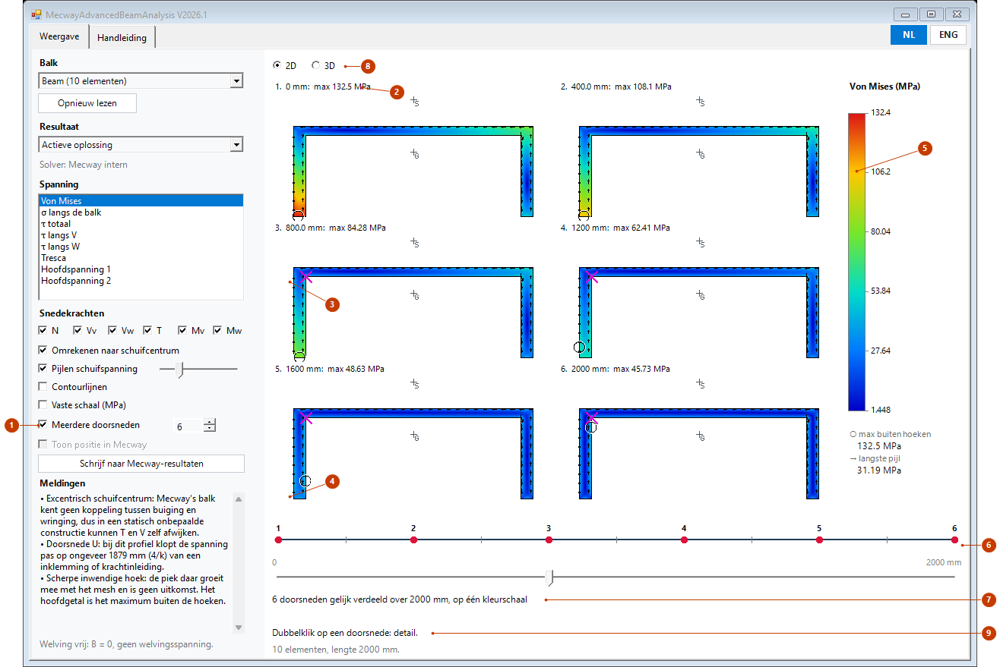

*Hetzelfde voorbeeld.*

| Nr | Onderdeel | Wat het doet |
|---|---|---|
| 1 | Meerdere doorsneden | Zet de tegels aan, gelijk verdeeld over de balk, de einden meegerekend. De schuifbalk en *Toon positie in Mecway* staan dan uit. |
| 2 | Kop van een tegel | Nummer, plaats en grootste waarde buiten de hoeken op die doorsnede. De nummers lopen van 1 aan het begin van de keten tot het laatste aan het eind. Het begin is het eind waar de meeste elementen in hun eigen knoopvolgorde vandaan lopen; bij gelijke stand het eind met het laagste knoopnummer. Past de kop niet in een smalle tegel, dan vervalt eerst de grootste waarde en dan de plaats; het nummer blijft. |
| 3 | ✕ op een tegel | Piek in de hoek, zoals nummer 20 hierboven. |
| 4 | ○ op een tegel | Maximum buiten de hoeken, zoals nummer 19. |
| 5 | Kleurschaal | Eén schaal voor alle tegels, dus kleuren zijn direct te vergelijken. |
| 6 | Zijaanzicht | Een rode stip per doorsnede, met hetzelfde nummer als de tegel. Het begin van de keten ligt links van het eind. Het nummer staat boven, onder of naast de stip. Is er bij een geknikte keten geen ruimte voor alle nummers, dan staan alleen 1, het laatste en elk zoveelste erbij. Bij een geknikte keten wijzen de nummers de einden aan, niet 0 en de lengte onderaan. |
| 7 | Samenvatting | Aantal doorsneden en lengte van de balk. |
| 8 | 2D / 3D | De tegels, of dezelfde doorsneden in 3D op hun plaats (§3.3). |
| 9 | Dubbelklik | Een dubbelklik op een tegel opent die doorsnede in detail (§3.3). |

De muis werkt ook op tegels: regel 24 noemt dan het nummer en de plaats erbij. Op een tegel zonder doorsnede staat er *Doorsnede n, plaats: geen doorsnede*.

### 3.3 3D-weergave en detail

Bij meerdere doorsneden staan dezelfde doorsneden ook in 3D op hun plaats langs de balk, met dezelfde nummers en
dezelfde kleurschaal. Het beeld draait, verschuift en zoomt met de muis. Een dubbelklik op een doorsnede opent die
doorsnede alleen, in detail; *Terug* brengt het overzicht terug zoals het was.

*De beelden in deze paragraaf zijn offscreen gemaakt, met hetzelfde eigen voorbeeld als §3.1 en een nagemaakte
oplossing; het rekenproces en de 3D-tekening zijn de echte. Hoe de focus en het muiswiel zich gedragen in het echte
venster naast Mecway is niet gemeten. Dat beoordeel je zelf.*

#### 3D

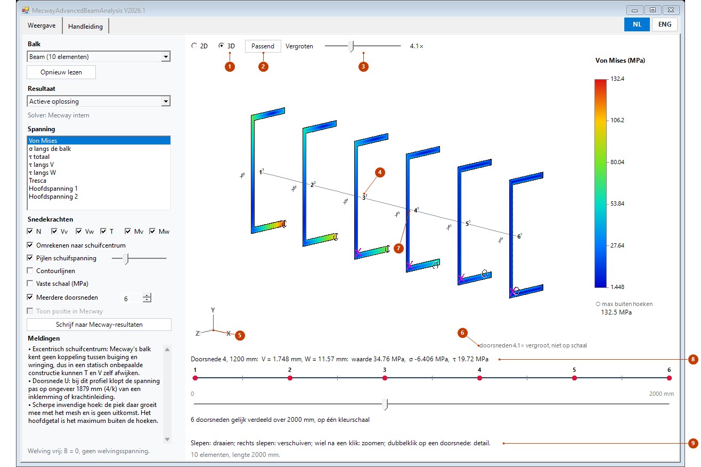

*Hetzelfde voorbeeld, iets gedraaid. De vergroting staat hier met de schuif op 4,1×; automatisch zou het 1,8× zijn, en
dan zijn de wanden van dit profiel maar een paar pixels breed.*

| Nr | Onderdeel | Wat het doet |
|---|---|---|
| 1 | 2D / 3D | Kiest tussen de tegels van §3.2 en de 3D-weergave. Staat er alleen bij meerdere doorsneden. De keuze blijft bewaard. |
| 2 | Passend | Zet de standaardcamera terug: de hele balk met de doorsneden in beeld, in de stand van Mecway's standaardbeeld: Y omhoog, X naar rechts, je kijkt van voren, iets van rechts (30°) en iets van boven (20°). Loopt de balk binnen 20° langs Y, dan is Z omhoog en kijk je van −Y. Zou je de doorsneden zo bijna op hun kant zien, dan kijkt de camera van links, of van hoger of lager. Je kijkt dus niet altijd tegen U in: een doorsnede kan gespiegeld lijken tegenover zijn tegel in 2D; de waarden onder de muis blijven gelijk. Dat Mecway standaard Y omhoog heeft, is niet gemeten. De vergroting verandert niet. |
| 3 | Vergroten | Helemaal links *Auto*, daarna 1× tot 100× in stappen op een logaritmische schaal. Rechts staat de factor: *Auto (1.8×)* of de gekozen, zoals hier *4.1×*. *Auto* maakt de grootste doorsnede ongeveer 1/(n+1) van de balklengte, met n het aantal doorsneden, tussen 1× en 100×. Waarom: zie hieronder. |
| 4 | Nummer | Het nummer van de doorsnede, hetzelfde als op de tegels en in het zijaanzicht. |
| 5 | Assen | X, Y en Z van het model, in dezelfde stand als het beeld. |
| 6 | Vergroting | *doorsneden k× vergroot, niet op schaal*. Staat er altijd als k niet 1 is. |
| 7 | Punt onder de muis | Hier wijst de muis een punt op de wand van doorsnede 4 aan. |
| 8 | Onder de muis | Nummer en plaats van de doorsnede, dan V, W, de gekozen waarde, σ en τ in dat punt. V en W zijn ware maten, niet vergroot. Staat een doorsnede bijna op zijn kant (minder dan 2°), dan alleen nummer en plaats. |
| 9 | Bediening | Een korte herinnering aan de muis, zie de tabel hieronder. |

De kleuren, de ✕ in een hoek, de ○ en de contourlijnen zijn die van de tegels in 2D, op één kleurschaal. De pijlen
voor schuifspanning tekent de 3D-weergave niet: in een schuin beeld zijn ze niet te lezen. Het vinkje blijft gewoon
staan voor 2D en detail.

**De muis in 3D**

| Muis | Wat het doet |
|---|---|
| Links slepen | Draait het beeld: opzij om de as die omhoog wijst, op en neer om te kantelen. Een sleep begint pas na een paar pixels, zodat een dubbelklik het beeld niet draait. |
| Rechts of middelste knop slepen | Verschuift het beeld. |
| Wiel | Zoomt naar de muis toe: het punt onder de muis blijft staan. **Alleen na een klik in het beeld**: zolang je niet in het beeld hebt geklikt, doet het wiel niets. Het venster pakt nooit zelf de focus. Krijgt iets anders de focus (een knop of veld in het venster, of Mecway), of wissel je van weergave of tabblad, dan eerst weer in het beeld klikken. Of een wielbeweging boven Mecway na zo'n klik toch bij het beeld komt, hangt af van Windows en is niet gemeten. |
| Dubbelklik op een doorsnede | Opent die doorsnede in detail, zie hieronder. Naast een doorsnede telt het nummer dat het dichtst bij ligt, binnen 16 pixels bij 100 % schermschaal. |
| Knop *Passend* | De standaardcamera terug (nummer 2). |

Tijdens slepen en zoomen verschijnt eerst een grof beeld zonder contourlijnen, bij stilstand het scherpe.

**Waarom de doorsneden vergroot zijn.** Een doorsnede is vaak tien tot honderd keer kleiner dan de balk lang is. Op
ware schaal zijn de doorsneden dan streepjes en is er geen kleur te zien. Daarom vergroot de tool elke doorsnede om
zijn eigen zwaartepunt G, dat op zijn plaats s langs de balk blijft. De plaatsen s blijven op ware afstand. De balk-as
tekent het venster als dunne lijn, op ware schaal.

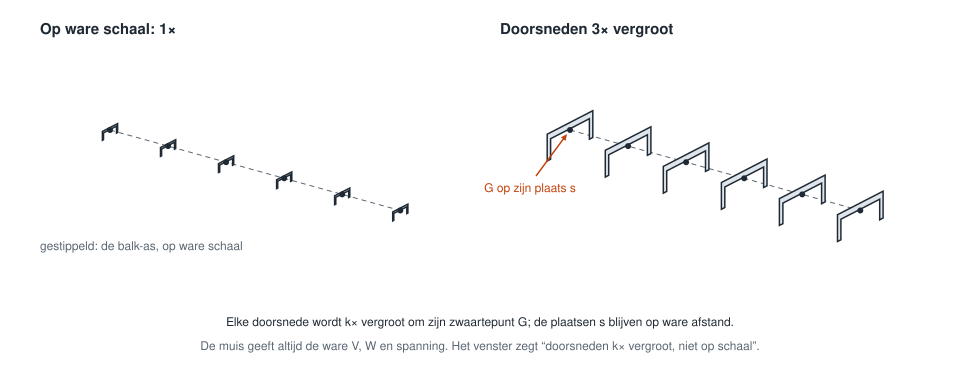

Het beeld is dus niet op schaal: een vergrote doorsnede kan over een buurdoorsnede heen vallen, en de afstand
tussen doorsneden zegt niets over hun maat. De tekst bij nummer 6 zegt dat steeds. De getallen zijn wel waar: de
muis, de kleurschaal en de tegels geven de ware V, W en spanning.

#### Detail van één doorsnede

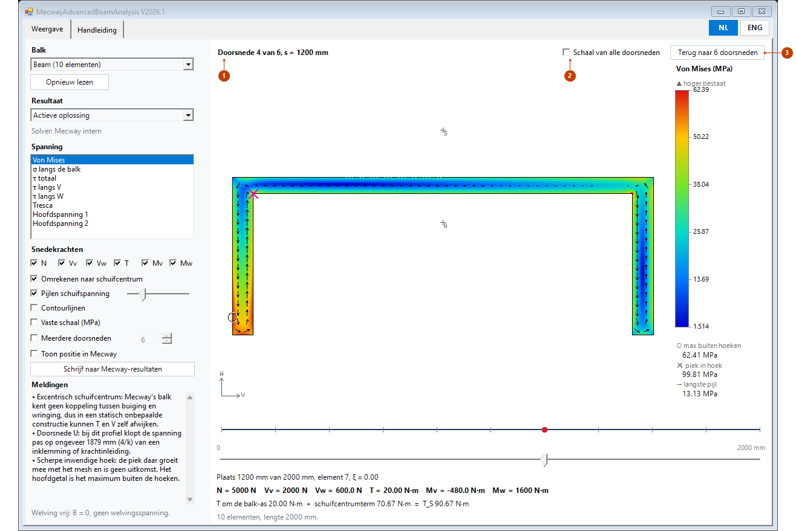

*Doorsnede 4 uit de 3D-weergave hierboven, na een dubbelklik.*

| Nr | Onderdeel | Wat het doet |
|---|---|---|
| 1 | Titel | Nummer, aantal en de exacte plaats van de doorsnede. Het venster toont nu één doorsnede, met alles van §3.1: zoomen, pijlen, de muis, *Toon positie in Mecway*. De schuifbalk staat op die plaats. Schuif je hem, dan volgt het beeld de schuifbalk en verdwijnt de titel; *Terug* blijft. |
| 2 | Schaal van alle doorsneden | Uit bij de start; de keuze blijft staan voor een volgend detail. Uit: de eigen schaal van deze ene doorsnede, zoals in §3.1. Hier loopt die tot 62,39 MPa. Aan: de kleurschaal van het overzicht, hier tot 132,4 MPa, zodat de kleuren te vergelijken zijn met de andere doorsneden. Dat geldt voor de spanningsmaat die gekozen was bij het openen; bij een andere maat is het vinkje grijs. Een eigen *Vaste schaal* (nummer 10 in §3.1) gaat voor. |
| 3 | Terug naar n doorsneden | Terug naar het overzicht zoals het was: het aantal, 2D of 3D, de camera, de vergroting en de vaste schaal (aan of uit, en de waarden). *Toon positie in Mecway* gaat weer uit, zoals altijd bij meerdere doorsneden. |

Een detail opent ook met een dubbelklik op een tegel in 2D. Zet je zelf *Meerdere doorsneden* weer aan, dan eindigt het
detail ook, maar zonder de bewaarde toestand terug te zetten.

### 3.4 Handleiding in het venster

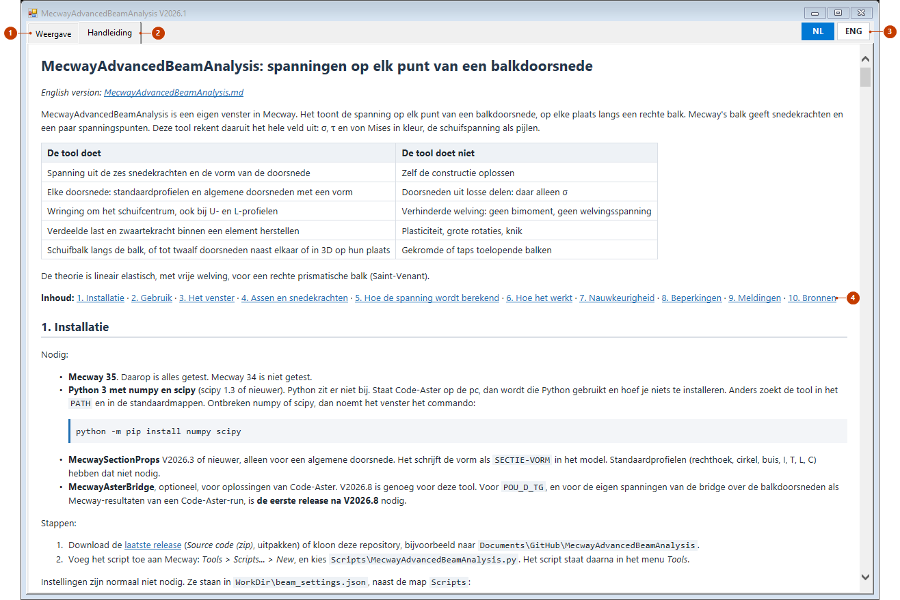

*Offscreen gemaakt, zoals de andere beelden: de handleiding zoals het venster hem toont.*

| Nr | Onderdeel | Wat het doet |
|---|---|---|
| 1 | Weergave | Het venster van §3.1 tot §3.3. Een ander tabblad kiezen stopt niets: het rekenproces rekent door, en schuifbalk, keuzes en camera blijven zoals ze waren. |
| 2 | Handleiding | Deze handleiding, met koppen, tabellen, code en alle beelden en tekeningen. Hij laadt pas als je dit tabblad opent. |
| 3 | NL / ENG | De handleiding volgt de taal: Nederlands of Engels. |
| 4 | Links | De inhoud bovenaan en elke verwijzing als §3.2 zijn links: een klik springt naar die paragraaf. De link naar de andere taal werkt als de knop van die taal. Een webadres opent in je eigen browser. |

De handleiding staat in de map `docs` naast de map `Scripts`, zoals in de release. Ontbreken de tekeningen in het tabblad,
kijk dan in `WorkDir\beam_log.txt` naar de regel met *document mode*: de tekeningen hebben 9 of hoger nodig. Hoe de
ingebouwde browser zich in Mecway gedraagt, is niet gemeten; offscreen was het 11.

## 4. Assen en snedekrachten

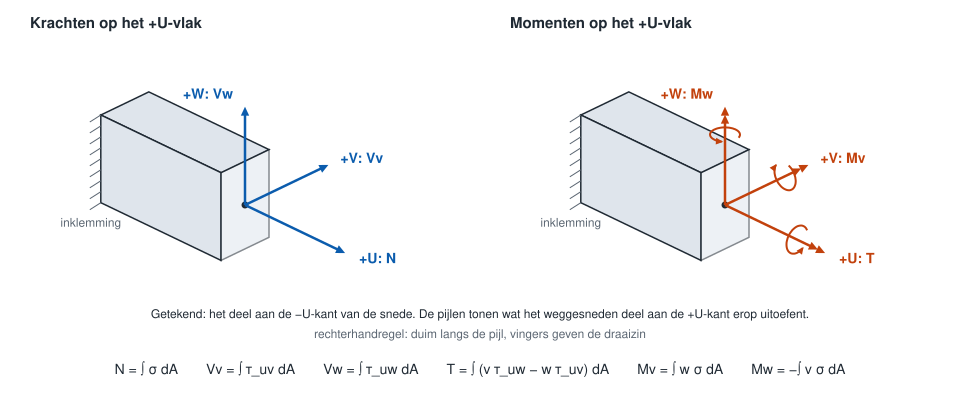

**Elementassen** (gemeten op Mecway 35). U loopt van de eerste naar de laatste knoop. Zonder *Element
orientation* is V = Z × U, en langs Z is V = Y. Daarna W = U × V. Een opgegeven vector wordt op het vlak
loodrecht op U geprojecteerd en met de hoek om U gedraaid. Een hoek zonder vector wordt genegeerd.

**Snedekrachten.** Dit zijn de componenten langs U, V en W van wat het deel aan de +U-kant uitoefent op de
rest. De momenten zijn vectoren met de rechterhandregel. De tekens zijn gelijk aan die van Code-Aster
(gemeten, ook bij omgekeerde knoopvolgorde en bij V = +Z).

| Venster | Mecway | Code-Aster | Betekenis |
|---|---|---|---|
| N | `tensileforce` | `N` | Kracht langs +U, trek is positief |
| Vv | `sheary` | `VY` | Dwarskracht langs +V |
| Vw | `shearz` | `VZ` | Dwarskracht langs +W |
| T | `torsion` | `MT` | Moment om +U, om de balk-as |
| Mv | `bendingmomv` | `MFY` | Moment om +V |
| Mw | `bendingmomw` | `MFZ` | Moment om +W |

Voorbeeld, gemeten op een cantilever langs +X met V = Y en W = Z, x gemeten vanaf de inklemming:

- Kracht +F langs +Y op de tip: `sheary` = +F en `bendingmomw` = +F·(L − x). Controle: het afgesneden deel
  duwt met +F op de rest, op arm (L − x) langs +U, en U × V = W geeft een moment om +W.
- Kracht +F langs +Z op de tip: `shearz` = +F en `bendingmomv` = −F·(L − x), want U × W = −V.
- Koppel om +X op de tip: `torsion` positief.

**Assen van de tekening.** De tool tekent elke doorsnede van één kant langs de keten. Ligt een element andersom
in de keten, dan draaien U en één van V, W om. Het beeld is dan gespiegeld ten opzichte van de elementassen. De
spanning op een fysiek punt blijft gelijk. Regel 28 en de pijlen staan in de assen van de tekening. Voor zo'n
element kan het teken dus afwijken van wat Mecway toont; de spanning is dezelfde.

**Doorsnede-assen.** V en W gaan door het zwaartepunt. Een `SECTIE-VORM` staat in hoofdassen. Mecway's C
heeft zijn lijf aan de +W-kant en zijn flenzen naar −W, zoals in de tekeningen hieronder (gemeten).

## 5. Hoe de spanning wordt berekend

Per doorsnede lost de tool op een mesh met kwadratische driehoeken (standaard ongeveer 3000) drie
Poisson-problemen op: ω voor wringing, ψ en φ voor dwarskracht, met ν in de vergelijking. Dat gebeurt één keer
per doorsnede. Daarna is de spanning lineair in de krachten, dus een nieuw beeld is alleen optellen. De
formulering is die van Pilkey (2002), in `section_fem.py`, en is overgenomen uit MecwaySectionProps.

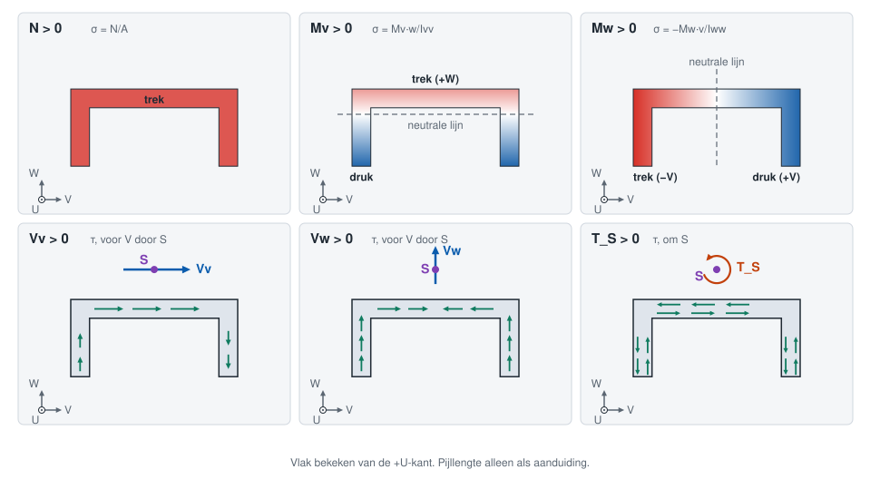

Zie je een doorsnede die gespiegeld is (§4), dan is de tekening dat ook; de waarden blijven gelijk.

### 5.1 Eigenschappen

σ rekent met A, Ivv, Iww en Ivw van de solver, zodat de spanning past bij het evenwicht dat de solver gebruikte.
De τ-velden komen uit het mesh van de doorsnede en zijn genormeerd op een eenheidsresultante. De integraal over
de doorsnede geeft dus precies V en T. Wijken de eigenschappen van vorm en model meer dan 1 % af, dan meldt het
venster dat (`props_differ`).

Ivv is het traagheidsmoment om de V-as, ∫ w² dA, en dat is Mecway's `iyy`. Iww = ∫ v² dA is Mecway's `izz`.

### 5.2 Normaalspanning

Met D = Ivv·Iww − Ivw²:

```
σ(v, w) = N/A + (Mv·Iww + Mw·Ivw)·w/D − (Mw·Ivv + Mv·Ivw)·v/D
```

In hoofdassen is Ivw = 0, en dan staat er σ = N/A + Mv·w/Ivv − Mw·v/Iww. De tool rekent altijd met de algemene
vorm, want een afgeronde `SECTIE-VORM` heeft een kleine Ivw.

### 5.3 Schuifspanning en het schuifcentrum

```
τ(v, w) = Vv·τ̂_Vv(v, w) + Vw·τ̂_Vw(v, w) + T_S·τ̂_T(v, w)
T_S = T + EY·Vw − EZ·Vv
```

τ̂_Vv, τ̂_Vw en τ̂_T zijn de eenheidsvelden. De twee velden voor dwarskracht werken door het schuifcentrum S. De
solver geeft T om de balk-as, en die loopt door het zwaartepunt G. Daarom verschuift de tool V naar S en telt het
moment daarvan bij T op. (EY, EZ) is de vector van S naar G, in V en W.

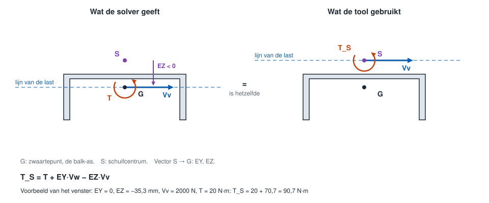

- Gaat de last door G, dan is T = 0 maar T_S niet: de doorsnede wringt toch.
- Gaat de last door S, dan is T_S = 0 en wringt de doorsnede niet.
- Bij een dubbelsymmetrische doorsnede vallen G en S samen en is de term nul.

De formule is gemeten in Code-Aster op `POU_D_E`, `POU_D_T` en `POU_D_TG`: 120 gevallen, fout 4,5e-8. De
solver-waarde T is daar de totale torsie om de meshlijn. Mecway's eigen balk geeft T ook om de as, en de tekens
zijn gelijk. Bij een Code-Aster-oplossing telt een afwijkende EY, EZ uit `#ASTER-SECTIE`, met een melding, zolang A, IY, IZ en JX
van die regel nog bij de doorsnede passen, zoals in de bridge (anders `aster_section_stale`).

### 5.4 Afgeleide maten

In deze theorie zijn de overige spanningen nul. Met τ = √(τv² + τw²):

| Maat | Formule |
|---|---|
| Von Mises | √(σ² + 3τ²) |
| Tresca | 2·√(σ²/4 + τ²) |
| Hoofdspanning 1 en 2 | σ/2 ± √(σ²/4 + τ²) |

### 5.5 Scherpe inwendige hoeken

In een scherpe inspringende hoek is de exacte spanning oneindig. De piek daar groeit dus mee met het mesh en is
geen uitkomst. Rond zo'n hoek legt de tool een zone met straal 1 × de plaatselijke dikte t. Het hoofdgetal is het
maximum buiten de zones. De piek staat erbij, met een ✕.

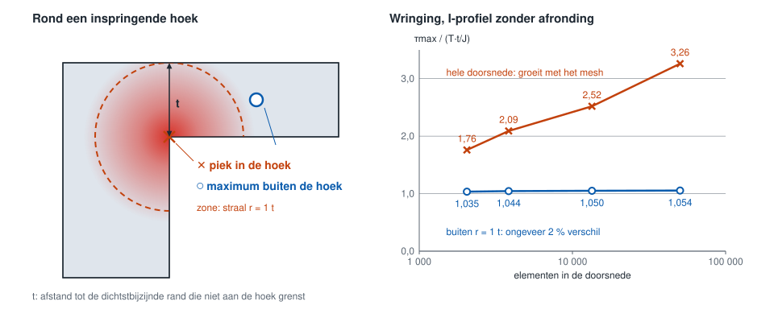

Buiten de zone verandert het maximum op dit I-profiel ongeveer 2 % over een factor 25 in mesh. Op de vijf
doorsneden van §7 blijft de fout buiten de zone binnen 5 %. De regel is daar getoetst op scherpe hoeken. Op L en U
zit de restfout niet bij de inspringende hoek maar in de bolle hoeken aan de wandeinden, en daar is het
volumemodel de beperking. Wie de echte piek wil weten, moet de afronding in de doorsnede opnemen.

### 5.6 Verdeelde last binnen een element

Mecway's eigen balk (line2) geeft onder een verdeelde last geen exacte waarden binnen een element. N, Vv en Vw
zijn constant en gelijk aan de waarde in het midden. Het moment is een rechte lijn die aan beide einden q·h²/12
naast het echte verloop ligt (gemeten).

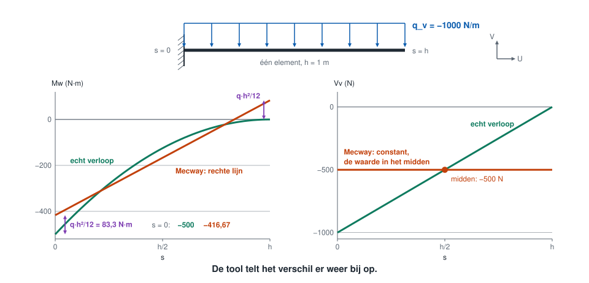

Voor een cantilever van 1 m met q_v = −1000 N/m:

| Grootheid | Eén element | Vier elementen | Exact aan de inklemming |
|---|---|---|---|
| Mw | −416,67 N·m | −494,79 N·m | −500 N·m |
| Vv, eerste element | −500 N | −875 N | −1000 N |

De tool leest de lasten uit de `.liml`, rekent ze om naar elementassen (q_u, q_v, q_w) en herstelt het verloop. Met s
de plaats in het element, van 0 tot h:

```
N(s)  = N_fem  + q_u·(h/2 − s)
Vv(s) = Vv_fem + q_v·(h/2 − s)                  Vw net zo, met q_w
Mw(s) = Mw_fem(s) + q_v·(h²/12 − s·(h − s)/2)
Mv(s) = Mv_fem(s) − q_w·(h²/12 − s·(h − s)/2)   Mw_fem, Mv_fem lineair tussen de eindwaarden
```

Dit geldt voor Mecway's line2. De tool bepaalt per oplossing welk geval het is. Blijft V aan beide einden gelijk
terwijl q niet nul is, dan zijn het middenwaarden. Verandert V met −q·h, dan zijn het eindwaarden en telt in M alleen
de term −s·(h − s)/2. CCX line3 is gemengd (gemeten): N en V zijn eindwaarden, M aan de hoekknopen draagt wel
q·h²/12. Code-Aster geeft onder `FORCE_POUTRE` eindwaarden; zwaartekracht op `POU_D_TG` geeft middenwaarden met
q·h²/12 (gemeten). Lukt de keuze niet, of is de last onbekend, dan blijft het verloop rechtlijnig en staat dat in de meldingen.

## 6. Hoe het werkt

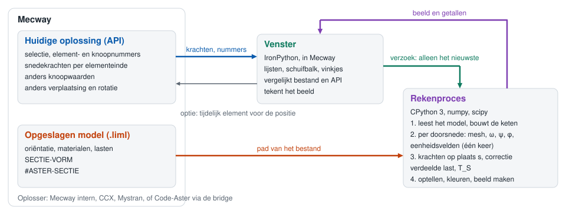

Het venster draait in Mecway op IronPython en heeft geen numpy. Het rekenwerk draait daarom in een apart proces, in
CPython. Het venster stuurt alleen het nieuwste verzoek en wacht nooit op het rekenproces, dus Mecway blijft bedienbaar.
Dat proces stopt zodra het venster sluit, of als Mecway verdwijnt.

Wat de tool per solver krijgt (gemeten op Mecway 35, tenzij anders vermeld):

| Solver | Elementtype | Route | Wat de tool krijgt | Let op |
|---|---|---|---|---|
| Mecway intern | line2 | Elementwaarden | Alle zes krachten per elementeinde, ook sprongen in een knoop | Verdeelde last: middenwaarden, correctie §5.6 |
| Mecway intern | line3 | Geen | Geen oplossing: geen knopen, geen elementen, geen fout | Gebruik line2 |
| CCX | line3 | Knoopwaarden | Alle zes krachten, zelfde tekens. M en V goed | Sprongen in een knoop zijn uitgemiddeld. Tegengesteld genummerde elementen: Vw en Mw 0 op zo'n knoop (`ccx_reversed`) |
| CCX | line2 | Knoopwaarden | Alle zes krachten, maar M is 14 % te laag (86 in plaats van 100) | Melding `ccx_line2`. Gebruik line3 |
| Mystran | balk | Kinematica | Alleen verplaatsing en rotatie, dus alleen N, Mv, Mw | Alleen σ. Zonder de vier veldvariabelen krijgt elke solver deze route, als de rotaties er zijn (anders `no_route`) |
| Code-Aster via MecwayAsterBridge | `POU_D_E`, `POU_D_T`, `POU_D_TG` | Elementwaarden | Alle zes krachten per element-knoop, zelfde tekens | `FORCE_POUTRE`: eindwaarden, line2 en line3. Zwaartekracht: eindwaarden op `POU_D_E`, middenwaarden met q·h²/12 op `POU_D_TG`. `POU_D_TG`: bridge V2026.9 of nieuwer. Bimoment wordt niet gebruikt. Opnieuw opgeslagen in Mecway: gelezen als Mecway intern |

## 7. Nauwkeurigheid

Getoetst tegen eigen volumemodellen (hex20, Code-Aster 17.4): rechthoek, I, koker, L en U, E = 210 GPa, ν = 0,3 (rechthoek
ook ν = 0). Alle getallen zijn gemeten. Details: `tests/validation/RESULTS.md`.

| Grootheid | Grootste fout | Marge vooraf |
|---|---|---|
| σ | 0,18 % (lange U, last door G; alle andere gevallen 0,01 % of minder) | 1 % |
| τ | 3,82 % (U onder wringing) | 5 % |
| τ met T_S | 3,54 % | 5 % |
| τ met kale T, op dezelfde L en U | 62,8 % of meer | - |

Zo moet je dit lezen:

- **Wat getoetst is.** Alleen de rekenkern. De snedekrachten zijn uit het volumemodel geïntegreerd en in de tool gezet.
  De toewijzing en tekens van echte solver-uitvoer vallen buiten deze toets; die zijn apart gemeten (§4, §6).
- **Maat.** Elk getal is de grootste afwijking gedeeld door de piek. Puntsgewijs, op punten boven 30 % van de piek, is
  τ groter: tot 6,4 % (U onder wringing), 4,6 % (L onder wringing), 4,1 % (L onder Y), 3,7 % (U onder Z). "τ ≤ 5 %" geldt
  dus niet per punt.
- **Waar.** Buiten de hoekzones en ver genoeg van de einden, zie hieronder. Op Gauss-punten, dus niet op de rand zelf.
- **Bovengrens.** Op L en U onder wringing daalt de fout nog met het mesh van het volumemodel.
- **De 0,18 %** op σ komt grotendeels van de rest van de verhinderde welving op die plaats (0,17 %). Die rekent de tool
  niet.
- **Poisson.** Op een rechthoek onder dwarskracht met ν = 0,3 ligt de piek in het volumemodel 44,6 % boven 1,5 V/A, en de
  tool volgt het volumemodel binnen 0,67 %. Dit is gemeten op dit ene geval.

**Grens bij open profielen.** Een inklemming en een krachtinleiding verstoren de welving. Bij een open profiel dempt
dat langzaam uit, met de lengte 1/k:

```
1/k = √(E·Iω / (G·J))
```

Een praktische regel (voorstel, gemeten op deze vijf doorsneden): de spanning klopt op minstens **max(5h, 4/k)** van een
inklemming of krachtinleiding. Het venster noemt 4/k bij zo'n profiel (melding `warping_zone`), zodra dat meer dan 5 % van de balklengte is; de grens
5h moet je zelf aanhouden. Voor de term T_S moet de
balk ook minstens 10/k lang zijn; kortere open balken zijn niet getoetst.

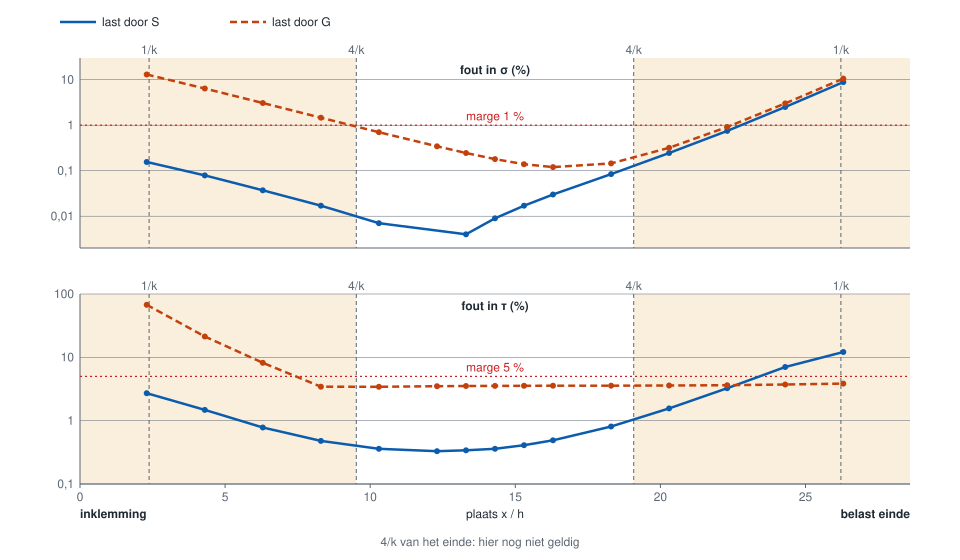

Gemeten op een U 100 × 50 mm van 28,6h lang, met 1/k = 2,38h. Ingeklemd op x = 0, belast op het andere einde met een
uniforme last, zodat de vrije welving daar ook verstoord wordt. Het vlakke stuk van de oranje τ-lijn is de 3,54 % uit de tabel.
Het strengste geval is de last door G bij de inklemming: 9,3h, dus 3,9/k, voor σ binnen 1 %.

De rekentijd is 0,1 tot 0,5 s per doorsnede. Een nieuw beeld kostte in de mediaan 2 tot 28 ms, buiten Mecway gemeten. De snelheid in Mecway
zelf is niet gemeten.

## 8. Beperkingen

- **Theorie.** Lineair elastisch, vrije welving, rechte prismatische balk. Geen σ_ω en geen secundaire schuif, ook niet aan
  een inklemming waar de welving verhinderd is. Plasticiteit, knik en grote rotaties vallen erbuiten.
- **Open profielen.** De spanning geldt pas op enige afstand van de einden (§7). Korte open balken (L < 10/k) zijn niet
  getoetst.
- **Statisch onbepaald met een excentrisch schuifcentrum.** Mecway's balk kent de koppeling tussen buiging en wringing niet.
  In zo'n constructie zijn T en V zelf al anders dan in werkelijkheid. Dat kan de tool niet herstellen.
- **Losse delen.** Een doorsnede uit losse delen heeft geen schuifvelden: alleen σ.
- **Scherpe hoeken.** Standaardprofielen hebben geen afrondingen. De piek in de hoek is geen uitkomst (§5.5). Afgeronde
  hoeken zijn niet getoetst.
- **Algemene doorsnede.** Zonder `SECTIE-VORM` is er geen beeld; de regels staan pas na opslaan in het bestand, en een
  hernoemd materiaal verliest ze. De punten van die vorm zijn afgerond, dus de eigenschappen kunnen iets afwijken: tot 1,8 %
  gemeten. Boven 5 % meldt de tool `shape_inertia`, want dan horen vorm en materiaal niet bij elkaar. Een balk met een andere
  U of V dan `SECTIE-RICHTING` geeft `section_direction`, ook bij een omgekeerde V (de vorm staat dan op zijn kop) of
  omgekeerde knoopvolgorde (gespiegeld). Dat geldt ook voor een dubbel symmetrische vorm, waar het niets uitmaakt.
- **Gekromd element.** Wordt als rechte balk gerekend, met een melding.
- **Modes en knik.** De grootte is willekeurig geschaald; alleen de verdeling zegt iets.
- **3D-weergave.** Alleen de gekozen doorsneden en de balk-as, zonder huid ertussen en zonder pijlen. De doorsneden zijn vergroot, dus
  het beeld is niet op schaal (§3.3). Focus en muiswiel in het echte venster naast Mecway zijn niet gemeten.
- **Configuraties.** Welke configuratie in Mecway actief is, staat niet in het bestand en is niet uit te lezen. Daarom kiest de tool hem zelf en zet hem actief, voor elk lezen en schrijven. Gemeten op Mecway 35: de oplossing wisselt mee, de oplossing van de andere configuratie blijft, en Mecway laat een last en een oriëntatie die in een configuratie onderdrukt zijn daar ook weg. Stappen en modes komen uit de oplossing die bij het lezen van de lijst actief was; heeft een andere configuratie andere stappen of modes, dan geeft het venster daar geen beeld maar een melding (niet gemeten: de gemeten configuraties waren statisch). Is de configuratie toch onbekend, dan gebruikt de tool niets wat in een configuratie is onderdrukt zonder het te zeggen: geen correctie voor die verdeelde last, en een balk met zo'n oriëntatie krijgt geen beeld. Een configuratie die Mecway niet (meer) kent, geeft een melding: sla het model op. Componenten en materialen per configuratie zijn niet getoetst.
- **Lasten.** Formules in x, y, z en lasten die de tool niet kent, worden niet gecorrigeerd. Dat geldt ook voor elementen met
  een flexibele verbinding of offset, en voor andere analyses dan statisch.
- **Oriëntatie.** Een oriëntatie met een formule kan de tool niet lezen.
- **Code-Aster.** Het bimoment wordt niet gebruikt. Slaat Mecway een Code-Aster-oplossing opnieuw op, dan is het spoor weg en
  leest de tool hem als Mecway intern (gemeten). Een mix van `FORCE_POUTRE` en zwaartekracht op `POU_D_TG` wordt niet gecorrigeerd.
- **Andere ν** dan 0 en 0,3 zijn niet getoetst, en Mecway 34 ook niet.

## 9. Meldingen

Alle teksten uit het venster. Schuingedrukte woorden worden ingevuld.

<!-- messages: written by tools/make_figures.py --messages -->

**Venster en rekenproces**

| Code | Tekst |
|---|---|
| `no_file` | Het model is niet opgeslagen. Sla het op in Mecway: oriëntatie en doorsnede staan alleen in het bestand. |
| `file_differs` | Het opgeslagen bestand wijkt af van het model in Mecway (*detail*). Sla het model op en kies Opnieuw lezen. |
| `selection_unsaved` | Selectie *naam* staat nog niet in het opgeslagen bestand. Via de API is een knoopselectie niet van een elementselectie te onderscheiden. Sla het model op en kies Opnieuw lezen. |
| `selection_unreadable` | Selectie *naam*: het opgeslagen bestand is niet te lezen, dus is niet te zeggen of dit een knoop- of een elementselectie is. Sla het model op en kies Opnieuw lezen. |
| `route_node` | Geen elementwaarden van deze solver: snedekrachten uit de knoopwaarden, sprongen in een gedeelde knoop zijn uitgemiddeld. |
| `route_kinematics` | Geen snedekrachten opgeslagen: alleen σ, uit de verplaatsingen en rotaties. Voeg de veldvariabelen tensile force, shear force, torsion moment en bending moment 2 toe aan het model en los opnieuw op voor τ en von Mises. |
| `route_kinematics_result` | Dit resultaat bevat geen snedekrachten, ook al staan de veldvariabelen in het model (gemeten: Mecway bewaart ze niet bij modes). Alleen σ, uit de verplaatsingen en rotaties. |
| `no_route` | Deze oplossing heeft geen snedekrachten en geen rotaties voor deze balk. |
| `separate_parts` | Doorsnede uit losse delen: geen schuifvelden, alleen σ. |
| `props_differ` | Doorsnede *naam*: vorm en eigenschappen in het model verschillen tot *percentage* %. σ rekent met het model, τ met de vorm. |
| `eccentric_shear_centre` | Excentrisch schuifcentrum: Mecway's balk kent geen koppeling tussen buiging en wringing, dus in een statisch onbepaalde constructie kunnen T en V zelf afwijken. |
| `aster_offset_used` | Doorsnede *naam*: EY, EZ uit #ASTER-SECTIE wijken *plaats* af van het schuifcentrum van de vorm. Voor deze Code-Aster-oplossing telt #ASTER-SECTIE. |
| `aster_offset_unused` | Doorsnede *naam*: EY, EZ uit #ASTER-SECTIE wijken *plaats* af van het schuifcentrum van de vorm. Deze oplossing komt niet herkenbaar van Code-Aster, dus telt de vorm. |
| `warping_zone` | Doorsnede *naam*: bij dit profiel klopt de spanning pas op ongeveer *plaats* (4/k) van een inklemming of krachtinleiding. |
| `mode_scaled` | Mode-oplossing: de grootte is willekeurig geschaald, alleen de verdeling zegt iets. |
| `corner_peak` | Scherpe inwendige hoek: de piek daar groeit mee met het mesh en is geen uitkomst. Het hoofdgetal is het maximum buiten de hoeken. |
| `configuration_active` | Configuratie *naam* in Mecway actief gezet: Mecway's actieve configuratie is niet uit te lezen, dus kiest de tool hem zelf. |
| `worker_died` | Het rekenproces is gestopt. |
| `import_failed` | De Python mist iets: *detail* |
| `internal` | Interne fout in het rekenproces, zie *logboek*. |
| `marker_on` | De positie staat als tijdelijk element *naam* in het model, alleen om te kijken en alleen zichtbaar in het modelbeeld. Zet de optie uit voor het oplossen: een modale analyse geeft er geen oplossing mee (gemeten). |
| `marker_left` | Een tijdelijk element van een vorige keer is verwijderd. |
| `marker_stuck` | Een tijdelijk element (*naam*) kon niet worden verwijderd. Verwijder het in Mecway. |
| `not_open` | Nog geen balk geopend. |
| `unknown_command` | Onbekende opdracht aan het rekenproces. |

**De keten**

| Code | Tekst |
|---|---|
| `empty` | Geen elementen gekozen. |
| `unknown_element` | Element *element* staat niet in het opgeslagen bestand. |
| `not_a_beam` | Element *element* is geen balk met doorsnede. |
| `missing_node` | Element *element*: knoop *knoop* ontbreekt in het bestand. |
| `zero_length` | Element *element* heeft lengte nul. |
| `branch` | De keuze vertakt in knoop *knoop*: kies één doorlopende lijn. |
| `gap` | De elementen vormen geen doorlopende lijn. |
| `closed_loop` | De keuze is een gesloten lus: kies een lijn met twee einden. |
| `fold_back` | De keten vouwt terug bij element *element*. |
| `orientation_configuration` | Element *element*: de oriëntatie is in een configuratie onderdrukt en welke configuratie is opgelost is niet bekend, dus de V-as ook niet. Kies Opnieuw lezen. |
| `orientation_formula` | Element *element*: oriëntatie met een formule kan de tool niet lezen. |
| `outside_chain` | Plaats buiten de keten. |
| `no_section_forces` | Element *element* mist *variabele*. |
| `no_young` | Element *element*: het materiaal heeft geen elasticiteitsmodulus. |
| `no_motion` | Element *element* mist verplaatsing of rotatie. |
| `kink` | Knik van *hoek*° bij *plaats* (element *element*): elke doorsnede rekent in het eigen element. |
| `section_twist` | Doorsnede draait *hoek*° bij *plaats* (element *element*). |
| `section_change` | Andere doorsnede vanaf *plaats*: *materiaal*. |
| `section_mirrored` | Bij *plaats* keert de knoopvolgorde om (element *element*): dezelfde doorsnede, gespiegeld getekend. |
| `frame_tie` | Element *element*: de tekenrichting van de doorsnede is een keuze, want beide kanten zijn even dichtbij. |
| `curved_element` | Element *element* is gekromd: gerekend als rechte balk. |
| `load_on_mid_node` | Puntlast op een middenknoop (*selectie*): het verloop binnen dat element klopt niet. |
| `ccx_line2` | CCX met line2-elementen: het moment is gemeten 14 % te laag. Gebruik line3. |
| `ccx_reversed` | CCX met tegengesteld genummerde elementen: knoopwaarden zijn gemiddelden in elementassen, gemeten Vw en Mw 0 op zo'n knoop. |
| `correction_skipped` | Geen correctie voor verdeelde last op *aantal* element(en) (*reden*): het verloop daarbinnen is rechtlijnig. |
| `load_convention_unknown` | Element *element*: niet te bepalen of de eindwaarden middenwaarden zijn; verdeelde last niet gecorrigeerd. |
| `kinematics_only` | Alleen N, Mv en Mw, uit de kinematica. |

**Het model**

| Code | Tekst |
|---|---|
| `bad_file` | Het bestand is niet te lezen: *detail* |
| `empty_model` | Het bestand bevat geen knopen. |
| `configuration_unknown` | *item* is in een configuratie onderdrukt, en welke configuratie is opgelost is niet bekend: de tool gebruikt het niet ongemerkt. |
| `configuration_missing` | Configuratie *naam* staat niet in het opgeslagen bestand. Sla het model op en kies Opnieuw lezen. |
| `bad_aster_section` | Materiaal *materiaal*: regel #ASTER-SECTIE niet te lezen. |
| `aster_section_stress` | Materiaal *materiaal*: #ASTER-SECTIE levert geen spanningen. |
| `aster_section_stale` | Materiaal *materiaal*: #ASTER-SECTIE past niet bij het materiaal (A, IY, IZ of JX); EY, EZ tellen niet. |
| `bad_shape` | SECTIE-VORM niet te lezen. |
| `bad_direction` | SECTIE-RICHTING niet te lezen: *detail* |
| `orientation_conflict` | Element *element* heeft twee oriëntaties. |

**De doorsnede**

| Code | Tekst |
|---|---|
| `no_shape` | Doorsnede *naam*: geen vorm in het opgeslagen model, dus geen beeld. Wijs de doorsnede toe met MecwaySectionProps en sla het model op: de regels staan pas na opslaan in de .liml. Een hernoemd materiaal verliest zijn vorm; wijs die dan opnieuw toe. |
| `stale_shape` | Doorsnede *naam*: de SECTIE-VORM past niet bij het materiaal (*detail*), dus geen beeld. Wijs de doorsnede opnieuw toe met MecwaySectionProps en sla het model op. |
| `section_direction` | Materiaal *materiaal*: *aantal* balk(en) passen niet bij de richting waarvoor de doorsnede is gemaakt (*reden*, *hoek* graden). De balk rekent dan met een gedraaide of gespiegelde doorsnede. Zet de V-as goed, of wijs de doorsnede opnieuw toe met MecwaySectionProps. |
| `shape_inertia` | Materiaal *materiaal*: de vorm past niet bij de eigenschappen. Omtrek: Ivv *waarde*, Iww *waarde* mm⁴; materiaal: iyy *waarde*, izz *waarde* mm⁴. De waarden zijn verwisseld of aangepast, of de vorm is te grof. σ rekent met het materiaal, τ met de vorm. Wijs de doorsnede opnieuw toe met MecwaySectionProps. |
| `no_poisson` | Doorsnede *naam*: het materiaal heeft geen Poisson-getal. |
| `missing_dimension` | Doorsnede *naam*: maat *detail* ontbreekt. |
| `bad_value` | Waarde niet te lezen: *detail* |
| `bad_dimensions` | Doorsnede *naam*: de maten kloppen niet (*detail*). |
| `unknown_section` | Doorsnede *naam*: onbekend type *detail*. |
| `mesh_failed` | Doorsnede *naam*: geen mesh mogelijk (*detail*). |
| `warping_failed` | Doorsnede *naam*: de wringing is niet op te lossen (*detail*). |
| `bad_properties` | Doorsnede *naam*: de eigenschappen kloppen niet (*detail*). |

<!-- end of messages -->

## 10. Bronnen

- W.D. Pilkey (2002), *Analysis and Design of Elastic Beams: Computational Methods*, Wiley. Formulering van `section_fem.py`.
  Het boek is voor deze tool niet ingezien; de formules zijn nagerekend via code en proefjes.
- F. Gruttmann, R. Sauer, W. Wagner (1998), *Shear stresses in prismatic beams with arbitrary cross-sections*.
- Code-Aster, documentatie R3.08.04 (`POU_D_TG`) en U4.42.01 (`AFFE_CARA_ELEM`).
- Mecway Ltd., *Mecway manual* (geïnstalleerd als `manual.pdf`).
