# MecwayAdvancedBeamAnalysis: the stress at every point of a beam section

*Nederlandse versie: [MecwayAdvancedBeamAnalysis.md](../MecwayAdvancedBeamAnalysis.md)*

MecwayAdvancedBeamAnalysis is a window of its own in Mecway. It shows the stress at every point of a beam section,
at any position along a straight beam. Mecway's beam gives section forces and a few stress points. This tool turns them
into the whole field: σ, τ and von Mises in colour, the shear stress as arrows.

| The tool does | The tool does not |
|---|---|
| Stress from the six section forces and the shape of the section | Solve the structure itself |
| Any section: standard profiles and general sections with a shape | Sections of separate parts: σ only there |
| Torsion about the shear centre, also on channels and angles | Restrained warping: no bimoment, no warping stress |
| Restore distributed load and gravity within an element | Plasticity, large rotations, buckling |
| Slider along the beam, or up to twelve sections side by side or in 3D at their place | Curved or tapered beams |

The theory is linear elastic, with free warping, for a straight prismatic beam (Saint-Venant).

**Contents:** [1. Installation](#1-installation) · [2. Use](#2-use) · [3. The window](#3-the-window) · [4. Axes and section forces](#4-axes-and-section-forces) · [5. How the stress is calculated](#5-how-the-stress-is-calculated) · [6. How it works](#6-how-it-works) · [7. Accuracy](#7-accuracy) · [8. Limitations](#8-limitations) · [9. Messages](#9-messages) · [10. References](#10-references)

## 1. Installation

Needed:

- **Mecway 35**. Everything was tested on it. Mecway 34 was not tested.
- **Python 3 with numpy and scipy** (scipy 1.3 or newer). Python is not included. With Code-Aster on the PC its Python
  is used and there is nothing to install. Otherwise the tool searches the `PATH` and the default folders. When numpy
  or scipy is missing, the window gives the command:

  ```bash
  python -m pip install numpy scipy
  ```

- **MecwaySectionProps** V2026.4 or newer, only for a general section. It writes the shape as `SECTIE-VORM` into the model. Standard
  profiles (rectangle, circle, tube, I, T, L, C) do not need it.
- **MecwayAsterBridge** V2026.9 or newer, optional, for Code-Aster solutions, also for `POU_D_TG` and for the
  bridge's own stresses over the beam sections as Mecway results of a Code-Aster run.

Steps:

1. Download the [latest release](https://github.com/trednuK/MecwayAdvancedBeamAnalysis/releases/latest)
   (*Source code (zip)*, unzip) or clone this repository, e.g. to `Documents\GitHub\MecwayAdvancedBeamAnalysis`.
2. Add the script to Mecway: *Tools* > *Scripts...* > *New*, and choose `Scripts\MecwayAdvancedBeamAnalysis.py`. The
   script then appears in the *Tools* menu.

Settings are not needed in the normal case. They are in `WorkDir\beam_settings.json`, next to the `Scripts` folder:

| Key | Meaning | Default |
|---|---|---|
| `language` | `nl` or `en` (the buttons NL and ENG of the window) | the Windows language |
| `python` | path of a `python.exe` with numpy and scipy | searched: Code-Aster, `PATH`, default folders |
| `python_found` | the Python the search found (written by the tool) | - |
| `contours` | contour lines on or off (written by the tool) | off |
| `sheet_view` | `2d` or `3d` with several sections (written by the tool) | `2d` |

The logs `beam_log.txt` and `beam_worker_log.txt` are in the same folder.

## 2. Use

1. **Make the beam model**, with line2 elements and a section. Give the beams the right *Element orientation*.
2. **Add four field variables before solving:** `tensile force`, `shear force`, `torsion moment` and
   `bending moment 2`. Right-click *Solution* in the tree, or open the *Solution* menu, and choose them. Mecway's manual
   says so. The exact menu items were not walked through for this tool; what was measured are the lines in the `.liml`
   file:

   ```xml
   <fieldvariable name="tensile force" displayunit="N" />
   <fieldvariable name="shear force" displayunit="N" />
   <fieldvariable name="torsion moment" displayunit="N.m" />
   <fieldvariable name="bending moment 2" displayunit="N.m" />
   ```

   Mecway stores only what is listed here (measured on Mecway 35). The tool never writes these lines itself, because a
   wrong name gives a message in Mecway that waits for a click. Without these variables you get σ only, from the
   displacements and rotations.
3. **Solve the model.** If you add the variables later, solve again.
4. **Save the model.** Orientation, materials, `SECTIE-VORM` and loads exist only in the file; the API does not give
   them. The window compares file and model (counts and coordinates) and asks to save when they differ.
5. **Select the beam elements** in Mecway, or make a named selection. Element and face selections both work. The elements
   must form one continuous line. A kink is allowed: each section is calculated in its own element, with a message. A
   named element selection you make or rename after the last save is listed as *not saved yet* and opens only after
   saving and **Read again**: the API gives the same numbers for a node and an element selection (measured), only the
   file tells which it is. The window recognises a face selection without the file as well.
6. **Start** *Tools* > `MecwayAdvancedBeamAnalysis`. The window stays open next to Mecway. Starting Python takes about
   2 s the first time. Starting again brings the open window to the front.
7. **Choose Beam and Result** (numbers 1 and 4 in §3). After a new selection, a new solution or saving, choose
   **Read again**.

## 3. The window

The window has two tabs: *View* with the sections (§3.1 to §3.3) and *Manual* with this text (§3.4).

### 3.1 One section

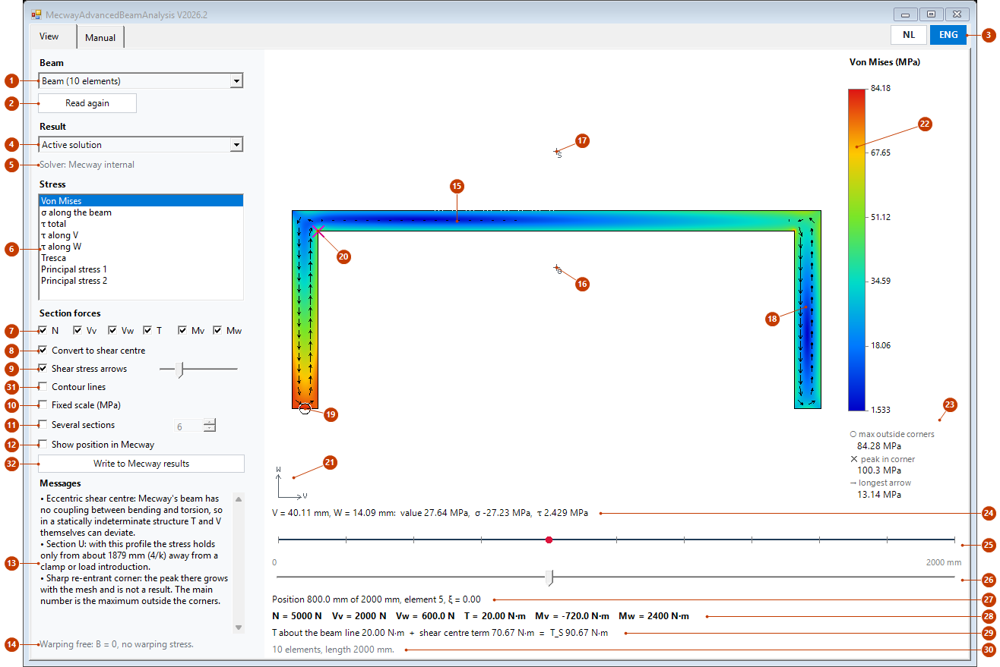

*Own example, not a measurement: a cantilever of 2 m with a channel 160 × 60 mm. The forces come from a fake solution; the
calculation process is the real one. On this short open section 4/k is nearly the whole beam, see `warping_zone` in §7.*

| No | Part | What it does |
|---|---|---|
| 1 | Beam | Choose *Current selection* or a named selection. In brackets the number of beam elements, or *not saved yet* for a selection that is not in the file yet (`selection_unsaved`, §9), or *file not readable* (`selection_unreadable`). |
| 2 | Read again | Reads selections, solution and file again. |
| 3 | NL / ENG | Chooses Dutch or English, for all texts and the manual. The chosen language is filled blue and is kept. The buttons are at the top right, on both tabs. |
| 4 | Result | *Active solution*, or a step, mode or buckling mode. When the model has configurations, every choice is listed per configuration, for example *Configuration A, Step 1*, also with one configuration. The tool then makes that configuration active in Mecway itself, also when the window opens, and says so. |
| 5 | Solver | The solver according to the saved file. |
| 6 | Stress | The measure in colour: von Mises, σ along the beam, τ total, τ along V, τ along W, Tresca, principal stress 1 and 2. Formulas in §5.4. Without section forces only σ remains. |
| 7 | Section forces | Turns N, Vv, Vw, T, Mv and Mw on and off one by one. The picture follows at once. A force that is off stands in brackets on line 28. |
| 8 | Convert to shear centre | On: the tool uses T_S (§5.3). Off: T as the solver gives it. Keep it on, unless T is already about the shear centre. |
| 9 | Shear stress arrows | Shows τ as arrows. The slider next to it sets their length. |
| 10 | Fixed scale | A fixed colour scale in MPa, from and to, per stress measure. Handy to compare positions. |
| 11 | Several sections | See §3.2 and §3.3. The number is the count, 2 to 12. |
| 12 | Show position in Mecway | Puts a temporary element at the position of the slider. Mecway then switches to the model view, because such an element is not visible in the solution view (measured). Turn it off before solving. The tool cleans up when closing. It is off by default. **Mind Undo (measured):** when you change something in Mecway while this is on, or press Undo then, Undo or Redo later puts the temporary element back into the model, also after the window is closed. So turn this off before you change anything else. An element that came back disappears at the next start of the window, or delete the component whose name starts with `Balkpositie_tijdelijk` yourself. |
| 13 | Messages | All you need to know about this picture. All texts are in §9. |
| 14 | Warping | Reminder: warping is free, so there is no warping stress. For a Code-Aster solution it says the bimoment is not included. |
| 15 | The colour picture | The section at the position of the slider. The mouse wheel zooms, dragging moves when zoomed in, a double click fits the picture again. |
| 16 | G | Centroid, the beam line. |
| 17 | S | Shear centre. On this channel it lies outside the section. |
| 18 | Arrows | Shear stress on a regular grid. |
| 19 | ○ | Largest value outside the corner zones. This is the main number (§5.5). |
| 20 | ✕ | Peak in a sharp re-entrant corner. This is not a result (§5.5). |
| 21 | Axes | V to the right, W up. You look along −U (§4). |
| 22 | Colour scale | Runs by default from the lowest to the highest value outside the corner zones. When values lie outside the scale, such as a peak in a corner or with a fixed scale, it says *▲ higher exists* or *▼ lower exists*. |
| 23 | Numbers | Maximum outside the corners, peak in the corner and the longest arrow. |
| 24 | Under the mouse | V, W, the chosen value, σ and τ at the point under the mouse. |
| 25 | Side view | The beam with element boundaries. The red dot is the position. |
| 26 | Slider | The position along the beam. Works with mouse, keys and wheel. |
| 27 | Position | Arc length, element and ξ (0 to 1 within the element). On a node the next element counts. |
| 28 | Section forces | The six forces at this position, in the axes of the drawing (§4). |
| 29 | Torque | T about the beam line, the shear centre term and T_S. |
| 30 | Status | What the tool is doing or just did. |
| 31 | Contour lines | Thin lines on the numbers of the colour scale, also on a fixed scale and with several sections. A line is white on dark blue and black on the other colours. Everything above the top value is one class, so a peak in a corner gives no bundle of lines. While zooming or resizing they appear only in the sharp picture. The choice is kept. |
| 32 | Write to Mecway results | Writes per node of the chosen beam the largest values outside the corners (with no room outside the corner zones: the overall largest) into the chosen result, as the node variables `sectionvonmises`, `sectionsigma` and `sectiontau`, in Pa. Other nodes get 0. The other results and the other steps or modes stay as they are. Without shear fields only `sectionsigma`. The values follow the check boxes at numbers 7 and 8. Save the model to keep them. |

Before writing, the tool compares the nodes of the solution with those of the model. When they differ it writes
nothing and asks whether it may solve again; it names the solver, and the current solution is then replaced. On a
solution of the bridge, or one with the shells of *Section in results*, it does not solve again: there the bridge
itself writes section forces on the beam and stress on the shells. That judgement comes from the saved file. On a
Code-Aster solution with shells Mecway also refuses the write itself (measured); on a plain Code-Aster solution the
button simply writes. With *Show position in Mecway* on, turn it off first.

### 3.2 Several sections

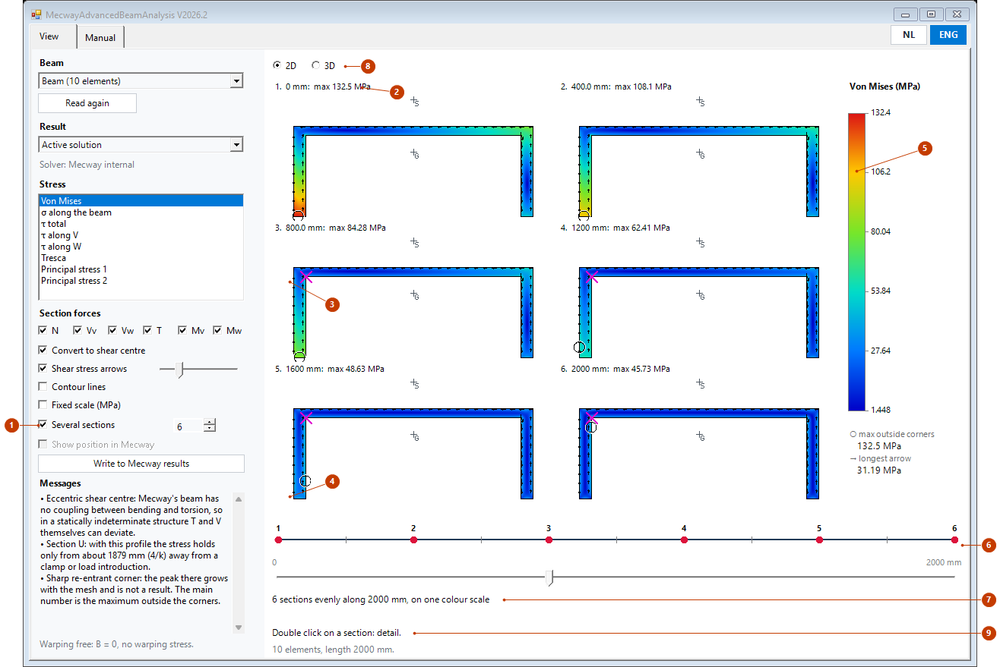

*The same example.*

| No | Part | What it does |
|---|---|---|
| 1 | Several sections | Turns the tiles on, evenly along the beam, the ends included. The slider and *Show position in Mecway* are then off. |
| 2 | Head of a tile | Number, position and largest value outside the corners on that section. The numbers run from 1 at the start of the chain to the last at its end. The start is the end from which most elements run in their own node order; on a tie the end with the lowest node number. When the head does not fit a narrow tile, first the largest value goes and then the position; the number stays. |
| 3 | ✕ on a tile | Peak in the corner, like number 20 above. |
| 4 | ○ on a tile | Maximum outside the corners, like number 19. |
| 5 | Colour scale | One scale for all tiles, so colours compare directly. |
| 6 | Side view | A red dot per section, with the same number as the tile. The start of the chain lies left of its end. The number stands above, below or beside the dot. When a bent chain leaves no room for all numbers, only 1, the last and every so many are shown. On a bent chain the numbers mark the ends, not 0 and the length at the bottom. |
| 7 | Summary | Number of sections and length of the beam. |
| 8 | 2D / 3D | The tiles, or the same sections in 3D at their place (§3.3). |
| 9 | Double click | A double click on a tile opens that section in detail (§3.3). |

The mouse works on tiles too: line 24 then adds the number and the position. On a tile without a section it says *Section n, position: no section*.

### 3.3 3D view and detail

With several sections the same sections also stand in 3D at their place along the beam, with the same numbers and
the same colour scale. The picture turns, moves and zooms with the mouse. A double click on a section opens that
section alone, in detail; *Back* brings the overview back as it was.

*The pictures in this section were made offscreen, with the same own example as §3.1 and a fake solution; the
calculation process and the 3D drawing are the real ones. How focus and the mouse wheel behave in the real window next
to Mecway was not measured. That is for you to judge.*

#### 3D

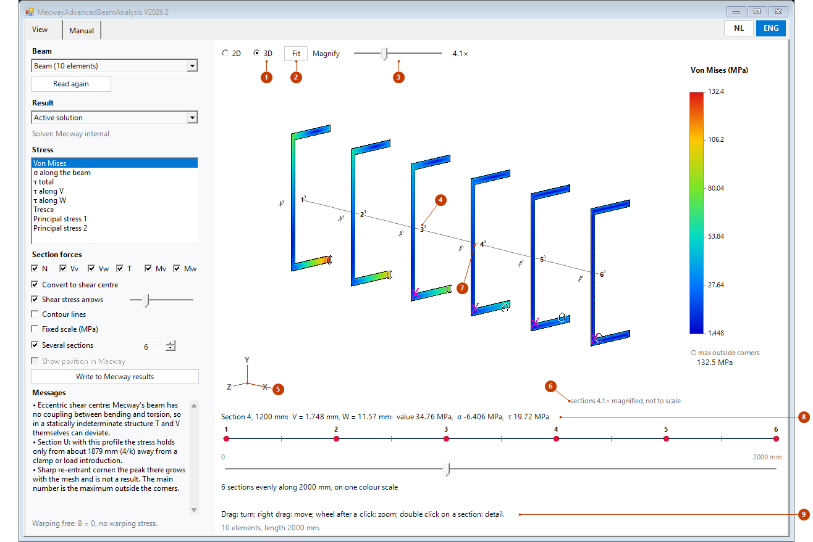

*The same example, turned a little. The magnification is set to 4.1× here with the slider; automatic would give 1.8×,
and then the walls of this section are only a few pixels wide.*

| No | Part | What it does |
|---|---|---|
| 1 | 2D / 3D | Chooses between the tiles of §3.2 and the 3D view. Shown only with several sections. The choice is kept. |
| 2 | Fit | Restores the default camera: the whole beam with its sections in view, with the up axis that Mecway uses (*Tools* > *Options* > *General*): Y up and you look from +Z, or Z up and you look from −Y. X points to the right, you look from the front, a little from the right (30°) and a little from above (20°). If that would show the sections nearly on their edge, the camera looks from the left, or from higher or lower. So you do not always look along −U: a section can look mirrored compared with its tile in 2D; the values under the mouse stay the same. A beam along the up axis stays standing. The magnification does not change. The window reads Mecway's saved choice the first time 3D opens for a beam, for another beam and at *Fit*; without that choice Y is up. Measured on Mecway 35: which axis is up. Not measured: whether Mecway's own front view also looks from +Z and −Y, and whether Mecway saves a changed choice already at OK. If *Fit* still shows the old axis, restart Mecway. |
| 3 | Magnify | Far left *Auto*, then 1× to 100× in steps on a logarithmic scale. On the right the factor: *Auto (1.8×)* or the chosen one, here *4.1×*. *Auto* makes the largest section about 1/(n+1) of the beam length, n being the number of sections, between 1× and 100×. Why: see below. |
| 4 | Number | The number of the section, the same as on the tiles and in the side view. |
| 5 | Axes | X, Y and Z of the model, turned with the picture. |
| 6 | Magnification | *sections k× magnified, not to scale*. Always shown when k is not 1. |
| 7 | Point under the mouse | Here the mouse points at a point on the wall of section 4. |
| 8 | Under the mouse | Number and position of the section, then V, W, the chosen value, σ and τ at that point. V and W are true sizes, not magnified. When a section stands nearly on its edge (less than 2°), only number and position. |
| 9 | Controls | A short reminder of the mouse, see the table below. |

The colours, the ✕ in a corner, the ○ and the contour lines are those of the tiles in 2D, on one colour scale. The 3D
view does not draw the shear stress arrows: in an oblique picture they cannot be read. The check box simply stays for
2D and the detail.

**The mouse in 3D**

| Mouse | What it does |
|---|---|
| Left drag | Turns the picture: sideways about the axis that points up, up and down to tilt. A drag starts only after a few pixels, so a double click does not turn the picture. |
| Right or middle button drag | Moves the picture. |
| Wheel | Zooms towards the mouse: the point under the mouse stays put. **Only after a click in the picture**: as long as you have not clicked in the picture, the wheel does nothing. The window never takes the focus by itself. When something else gets the focus (a button or box in the window, or Mecway), or you switch views or tabs, click in the picture again first. Whether a wheel movement over Mecway after such a click still reaches the picture depends on Windows and was not measured. |
| Double click on a section | Opens that section in detail, see below. Beside a section the nearest number counts, within 16 pixels at 100 % display scale. |
| *Fit* button | The default camera back (number 2). |

While dragging and zooming a coarse picture without contour lines comes first, the sharp one when you stop.

**Why the sections are magnified.** A section is often ten to a hundred times smaller than the beam is long. At true
scale the sections are then dashes and no colour shows. So the tool magnifies each section about its own centroid G,
which stays at its position s along the beam. The positions s stay at their true distance. The window draws the beam
line as a thin line, to scale.

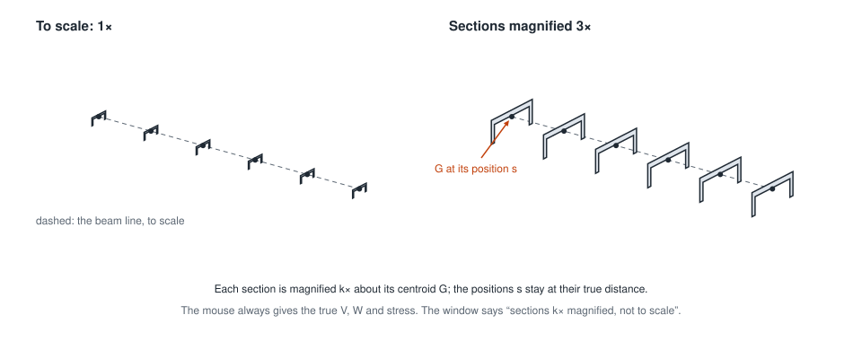

So the picture is not to scale: a magnified section can overlap its neighbour, and the distance between sections says
nothing about their size. The text at number 6 always says so. The numbers are true: the mouse, the colour scale and
the tiles give the true V, W and stress.

#### Detail of one section

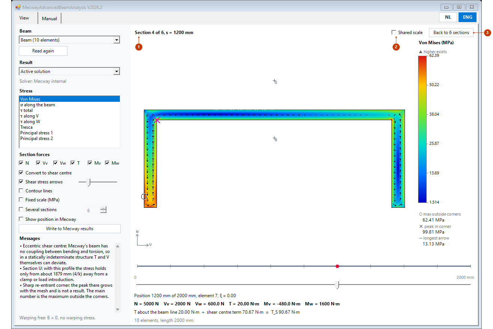

*Section 4 from the 3D view above, after a double click.*

| No | Part | What it does |
|---|---|---|
| 1 | Title | Number, count and the exact position of the section. The window now shows one section, with everything of §3.1: zoom, arrows, the mouse, *Show position in Mecway*. The slider stands at that position. When you move it, the picture follows the slider and the title goes; *Back* stays. |
| 2 | Shared scale | Off at the start; the choice stays for a next detail. Off: the own scale of this one section, as in §3.1. Here it runs to 62.39 MPa. On: the colour scale of the overview, here up to 132.4 MPa, so that the colours compare with the other sections. This holds for the stress measure chosen when the detail opened; for another measure the check box is grey. Your own *Fixed scale* (number 10 in §3.1) comes first. |
| 3 | Back to n sections | Back to the overview as it was: the count, 2D or 3D, the camera, the magnification and the fixed scale (on or off, and the values). *Show position in Mecway* goes off again, as always with several sections. |

A detail also opens with a double click on a tile in 2D. When you turn *Several sections* on again yourself, the detail
ends too, but without restoring the saved state.

### 3.4 Manual in the window

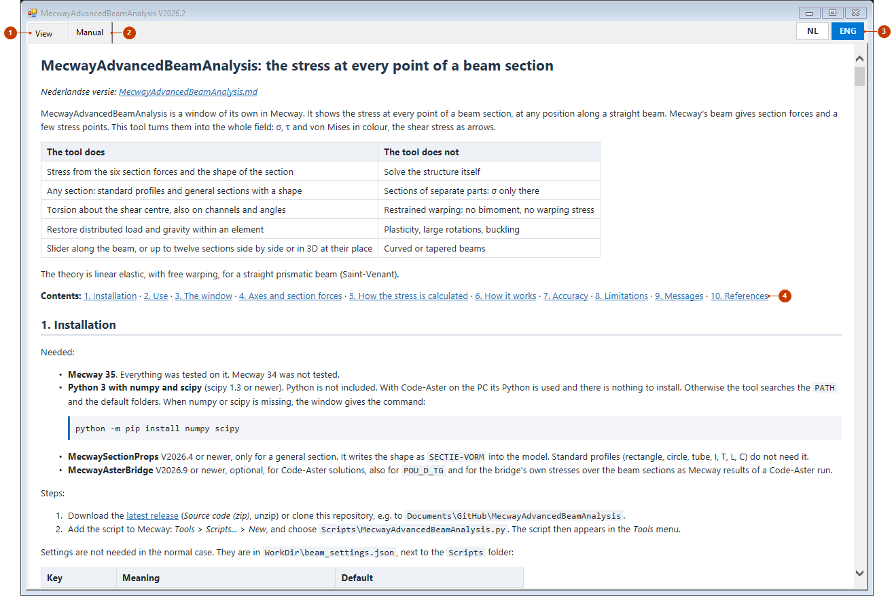

*Made offscreen, like the other images: the manual as the window shows it.*

| No | Part | What it does |
|---|---|---|
| 1 | View | The window of §3.1 to §3.3. Choosing another tab stops nothing: the calculation process goes on, and slider, choices and camera stay as they were. |
| 2 | Manual | This manual, with headings, tables, code and all images and drawings. It loads only when you open this tab. |
| 3 | NL / ENG | The manual follows the language: Dutch or English. |
| 4 | Links | The contents at the top and every reference such as §3.2 are links: a click jumps to that section. The link to the other language works like the button of that language. A web address opens in your own browser. |

The manual is in the folder `docs` next to the folder `Scripts`, as in the release. When the drawings are missing on the tab, look in
`WorkDir\beam_log.txt` for the line with *document mode*: the drawings need 9 or higher. How the built-in browser behaves
inside Mecway was not measured; offscreen it was 11.

## 4. Axes and section forces

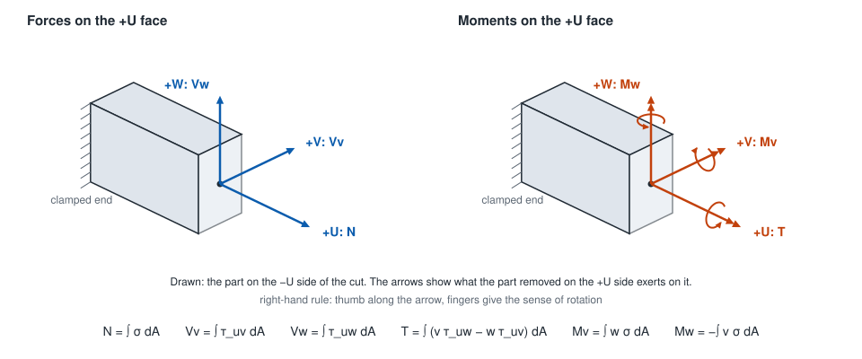

**Element axes** (measured on Mecway 35). U runs from the first to the last node. Without an *Element orientation*
V = Z × U, and along Z V = Y. Then W = U × V. A given vector is projected on the plane normal to U and turned about U by
the angle. An angle without a vector is ignored.

**Section forces.** These are the components along U, V and W of what the part on the +U side exerts on the rest. Moments
are vectors with the right-hand rule. The signs equal those of Code-Aster (measured, also with reversed node order and
with V = +Z).

| Window | Mecway | Code-Aster | Meaning |
|---|---|---|---|
| N | `tensileforce` | `N` | Force along +U, tension is positive |
| Vv | `sheary` | `VY` | Shear force along +V |
| Vw | `shearz` | `VZ` | Shear force along +W |
| T | `torsion` | `MT` | Moment about +U, about the beam line |
| Mv | `bendingmomv` | `MFY` | Moment about +V |
| Mw | `bendingmomw` | `MFZ` | Moment about +W |

Example, measured on a cantilever along +X with V = Y and W = Z, x from the clamped end:

- Force +F along +Y at the tip: `sheary` = +F and `bendingmomw` = +F·(L − x). Check: the removed part pushes with +F on
  the rest, at arm (L − x) along +U, and U × V = W gives a moment about +W.
- Force +F along +Z at the tip: `shearz` = +F and `bendingmomv` = −F·(L − x), because U × W = −V.
- Couple about +X at the tip: `torsion` positive.

**Axes of the drawing.** The tool draws every section from one side along the chain. When an element lies the other way
in the chain, U and one of V, W turn round. The picture is then mirrored against the element axes. The stress at a physical
point stays the same. Line 28 and the arrows are in the axes of the drawing. For such an element the sign can therefore differ
from what Mecway shows; the stress is the same.

**Section axes.** V and W go through the centroid. A `SECTIE-VORM` is in principal axes. Mecway's C has its web on the +W
side and its flanges towards −W, as in the drawings below (measured).

## 5. How the stress is calculated

For each section the tool solves three Poisson problems on a mesh of quadratic triangles (about 3000 by default): ω for
torsion, ψ and φ for shear, with ν in the equation. That happens once per section. After that the stress is linear in the
forces, so a new picture is only adding up. The formulation is that of Pilkey (2002), in `section_fem.py`, taken over from
MecwaySectionProps.

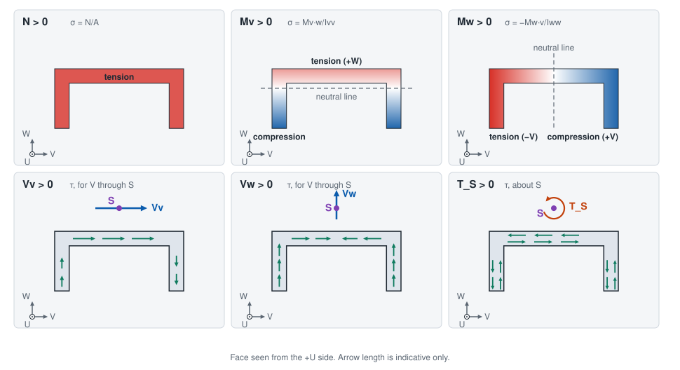

If a section is mirrored (§4), the drawing is too; the values stay the same.

### 5.1 Properties

σ uses A, Ivv, Iww and Ivw of the solver, so that the stress fits the equilibrium the solver used. The τ fields come from the
mesh of the section and are normalised on a unit resultant. The integral over the section therefore gives exactly V and T.
When the properties of shape and model differ by more than 1 %, the window says so (`props_differ`).

Ivv is the second moment about the V axis, ∫ w² dA, which is Mecway's `iyy`. Iww = ∫ v² dA is Mecway's `izz`.

### 5.2 Normal stress

With D = Ivv·Iww − Ivw²:

```
σ(v, w) = N/A + (Mv·Iww + Mw·Ivw)·w/D − (Mw·Ivv + Mv·Ivw)·v/D
```

In principal axes Ivw = 0, which gives σ = N/A + Mv·w/Ivv − Mw·v/Iww. The tool always uses the general form, because a
rounded `SECTIE-VORM` has a small Ivw.

### 5.3 Shear stress and the shear centre

```
τ(v, w) = Vv·τ̂_Vv(v, w) + Vw·τ̂_Vw(v, w) + T_S·τ̂_T(v, w)
T_S = T + EY·Vw − EZ·Vv
```

τ̂_Vv, τ̂_Vw and τ̂_T are the unit fields. The two shear fields act through the shear centre S. The solver gives T about the
beam line, which runs through the centroid G. So the tool moves V to S and adds its moment to T. (EY, EZ) is the vector from
S to G, in V and W.

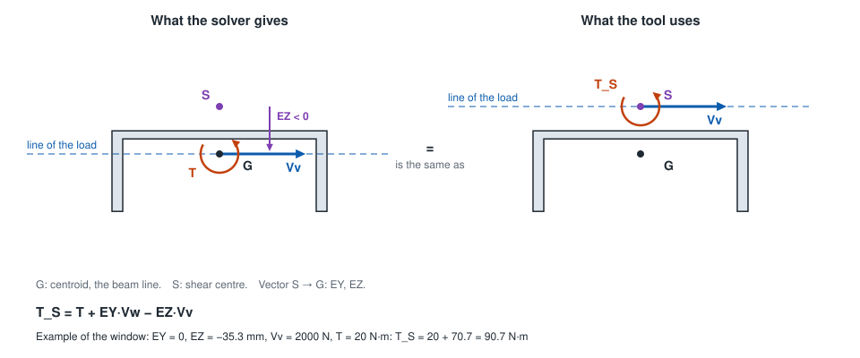

- When the load goes through G, T = 0 but T_S is not: the section twists all the same.
- When the load goes through S, T_S = 0 and the section does not twist.
- In a doubly symmetric section G and S coincide and the term is zero.

The formula was measured in Code-Aster on `POU_D_E`, `POU_D_T` and `POU_D_TG`: 120 cases, error 4.5e-8. The solver value T is
there the total torsion about the mesh line. Mecway's own beam also gives T about the line, and the signs are equal. For a Code-Aster solution a differing EY, EZ from `#ASTER-SECTIE` counts, with a message, as long as A, IY, IZ and JX of
that line still fit the section, as in the bridge (otherwise `aster_section_stale`).

### 5.4 Derived measures

In this theory the other stresses are zero. With τ = √(τv² + τw²):

| Measure | Formula |
|---|---|
| Von Mises | √(σ² + 3τ²) |
| Tresca | 2·√(σ²/4 + τ²) |
| Principal stress 1 and 2 | σ/2 ± √(σ²/4 + τ²) |

### 5.5 Sharp re-entrant corners

In a sharp re-entrant corner the exact stress is infinite. So the peak there grows with the mesh and is not a result. Around
such a corner the tool puts a zone of radius 1 × the local thickness t. The main number is the maximum outside the zones.
The peak is shown as well, with a ✕.

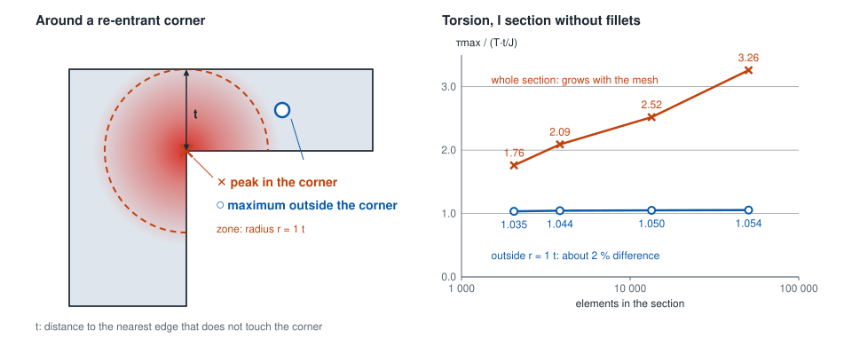

Outside the zone the maximum on this I section changes about 2 % over a factor of 25 in mesh. On the five sections of §7 the
error outside the zone stays within 5 %. The rule was tested there on sharp corners. On L and U the remaining error is not at
the re-entrant corner but in the convex corners at the wall ends, and there the solid model is the limit. If you want the true
peak, put the fillet in the section.

### 5.6 Distributed load within an element

Under a distributed load Mecway's own beam (line2) gives no exact values within an element. N, Vv and Vw are constant and equal
to the value in the middle. The moment is a straight line that lies q·h²/12 off the true course at both ends (measured).

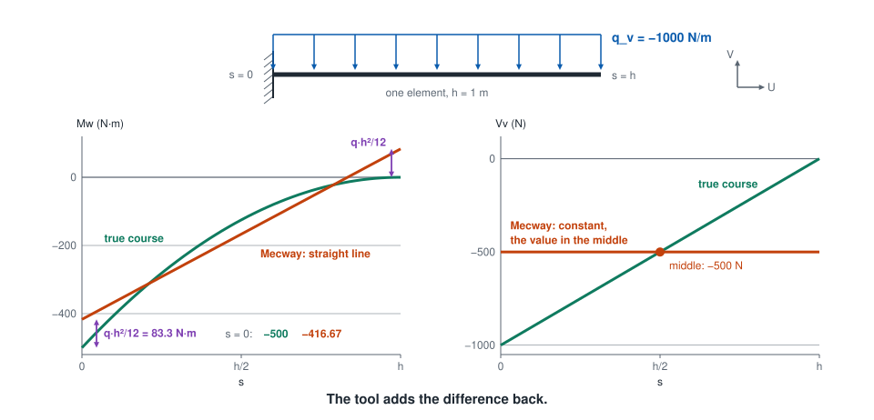

For a cantilever of 1 m with q_v = −1000 N/m:

| Quantity | One element | Four elements | Exact at the clamped end |
|---|---|---|---|
| Mw | −416.67 N·m | −494.79 N·m | −500 N·m |
| Vv, first element | −500 N | −875 N | −1000 N |

The tool reads the loads from the `.liml`, converts them to element axes (q_u, q_v, q_w) and restores the course. With s the
position in the element, from 0 to h:

```
N(s)  = N_fem  + q_u·(h/2 − s)
Vv(s) = Vv_fem + q_v·(h/2 − s)                  Vw alike, with q_w
Mw(s) = Mw_fem(s) + q_v·(h²/12 − s·(h − s)/2)
Mv(s) = Mv_fem(s) − q_w·(h²/12 − s·(h − s)/2)   Mw_fem, Mv_fem linear between the end values
```

This holds for Mecway's line2. The tool decides per solution which case it is. When V stays equal at both ends while q is not
zero, they are midpoint values. When V changes by −q·h, they are end values, and in M only the term −s·(h − s)/2 counts. CCX line3
is mixed (measured): N and V are end values, M at the corner nodes does carry q·h²/12. Code-Aster gives end values under `FORCE_POUTRE`; gravity on `POU_D_TG` gives midpoint values with
q·h²/12 (measured). If the choice fails, or the load is
unknown, the course stays linear and the messages say so.

## 6. How it works

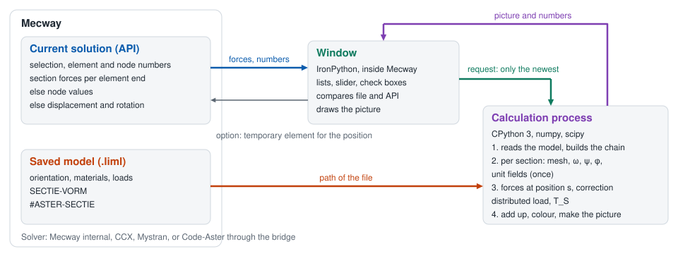

The window runs in Mecway on IronPython, which has no numpy. So the calculation runs in a separate process, in CPython. The
window sends only the newest request and never waits for the process, so Mecway stays usable. The process stops when the window
closes, or when Mecway disappears.

What the tool gets per solver (measured on Mecway 35, unless stated otherwise):

| Solver | Element type | Route | What the tool gets | Note |
|---|---|---|---|---|
| Mecway internal | line2 | Element values | All six forces per element end, also jumps at a node | Distributed load: midpoint values, correction §5.6 |
| Mecway internal | line3 | None | No solution: no nodes, no elements, no error | Use line2 |
| CCX | line3 | Node values | All six forces, same signs. M and V right | Jumps at a node are averaged. Elements numbered in opposite directions: Vw and Mw 0 at such a node (`ccx_reversed`) |
| CCX | line2 | Node values | All six forces, but M is 14 % too low (86 instead of 100) | Message `ccx_line2`. Use line3 |
| Mystran | beam | Kinematics | Only displacement and rotation, so only N, Mv, Mw | σ only. Without the four field variables every solver takes this route, when the rotations exist (otherwise `no_route`) |
| Code-Aster through MecwayAsterBridge | `POU_D_E`, `POU_D_T`, `POU_D_TG` | Element values | All six forces per element node, same signs | `FORCE_POUTRE`: end values, line2 and line3. Gravity: end values on `POU_D_E`, midpoint values with q·h²/12 on `POU_D_TG`. `POU_D_TG`: bridge V2026.9 or newer. The bimoment is not used. Saved again in Mecway: read as Mecway internal |

## 7. Accuracy

Tested against own solid models (hex20, Code-Aster 17.4): rectangle, I, box, L and U, E = 210 GPa, ν = 0.3 (rectangle also
ν = 0). All numbers are measured. Details: `tests/validation/RESULTS.md`.

| Quantity | Largest error | Margin set in advance |
|---|---|---|
| σ | 0.18 % (long U, load through G; all other cases 0.01 % or less) | 1 % |
| τ | 3.82 % (U under torsion) | 5 % |
| τ with T_S | 3.54 % | 5 % |
| τ with plain T, on the same L and U | 62.8 % or more | - |

How to read this:

- **What was tested.** The stress core only. The section forces were integrated from the solid model and put into the tool.
  The assignment and signs of real solver output are outside this test; they were measured separately (§4, §6).
- **Measure.** Every number is the largest deviation divided by the peak. Point by point, on points above 30 % of the peak, τ is
  larger: up to 6.4 % (U under torsion), 4.6 % (L under torsion), 4.1 % (L under Y), 3.7 % (U under Z). So "τ ≤ 5 %" does not hold
  per point.
- **Where.** Outside the corner zones and far enough from the ends, see below. On Gauss points, so not on the edge itself.
- **Upper bound.** On L and U under torsion the error still falls with the mesh of the solid model.
- **The 0.18 %** on σ comes mostly from the rest of the restrained warping at that place (0.17 %). The tool does not
  calculate that.
- **Poisson.** On a rectangle under shear with ν = 0.3 the peak in the solid model lies 44.6 % above 1.5 V/A, and the tool follows
  the solid model within 0.67 %. This was measured on this one case.

**Limit on open sections.** A clamped end and a load introduction disturb the warping. On an open section that dies out slowly,
with the length 1/k:

```
1/k = √(E·Iω / (G·J))
```

A practical rule (a proposal, measured on these five sections): the stress holds at **max(5h, 4/k)** or more from a clamped end
or load introduction. The window gives 4/k on such a section (message `warping_zone`) when it is more than 5 % of the beam length; the 5h limit you
keep yourself. For the T_S term the beam must also be at
least 10/k long; shorter open beams were not tested.

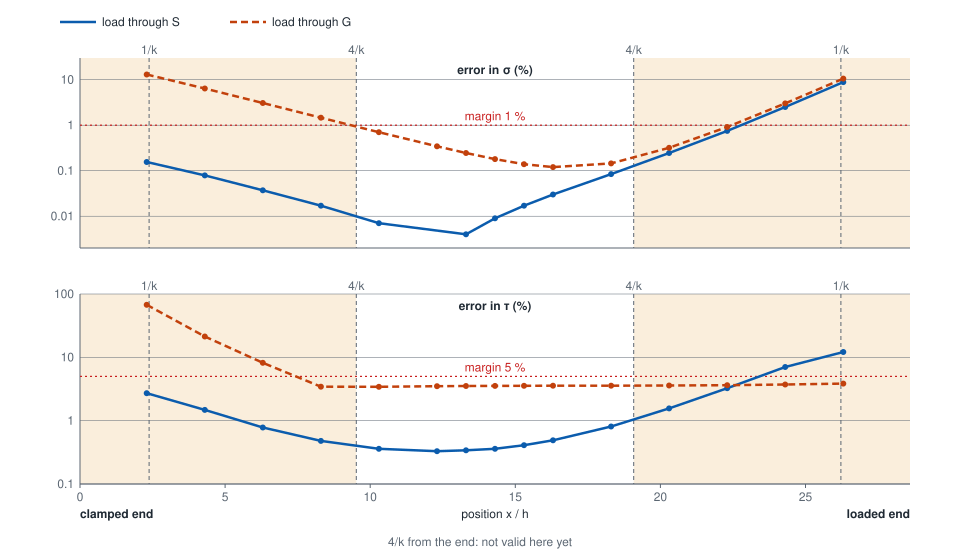

Measured on a channel 100 × 50 mm, 28.6h long, with 1/k = 2.38h. Clamped at x = 0, loaded at the other end with a uniform load, so
that free warping is disturbed there too. The flat part of the orange τ line is the 3.54 % of the table. The strictest case is the
load through G at the clamped end: 9.3h, so 3.9/k, for σ within 1 %.

Run time is 0.1 to 0.5 s per section. A new picture took 2 to 28 ms in the median, measured outside Mecway. The speed inside Mecway itself was not
measured.

## 8. Limitations

- **Theory.** Linear elastic, free warping, straight prismatic beam. No σ_ω and no secondary shear, also not at a clamped end where
  warping is restrained. Plasticity, buckling and large rotations are outside it.
- **Open sections.** The stress holds only at some distance from the ends (§7). Short open beams (L < 10/k) were not tested.
- **Statically indeterminate with an eccentric shear centre.** Mecway's beam has no coupling between bending and torsion. In such a
  structure T and V themselves already differ from reality. The tool cannot repair that.
- **Separate parts.** A section of separate parts has no shear fields: σ only.
- **Sharp corners.** Standard profiles have no fillets. The peak in the corner is not a result (§5.5). Rounded corners were not tested.
- **General section.** Without `SECTIE-VORM` there is no picture; the lines are in the file only after saving, and a renamed
  material loses them. The points of that shape are rounded, so the properties can differ a little: up to 1.8 % measured. Above
  5 % in Ivv or Iww the tool gives `shape_inertia`, because shape and material do not belong together. A beam with another U or V than `SECTIE-RICHTING` gives
  `section_direction`, also with a reversed V (the shape then stands on its head) or reversed node order (mirrored). That also
  holds for a doubly symmetric shape, where it makes no difference.
- **Curved element.** Calculated as a straight beam, with a message.
- **Modes and buckling.** The size is scaled arbitrarily; only the distribution means something.
- **3D view.** Only the chosen sections and the beam line, with no skin between them and no arrows. The sections are magnified, so the
  picture is not to scale (§3.3). Focus and mouse wheel in the real window next to Mecway were not measured.
- **Configurations.** Which configuration is active in Mecway is not in the file and cannot be read. So the tool chooses it itself and makes it active, for every read and write. Measured on Mecway 35: the solution follows, the solution of the other configuration stays, and Mecway also leaves out a load and an orientation that are suppressed in a configuration. Steps and modes come from the solution that was active when the list was read; when another configuration has other steps or modes, the window gives no picture there but a message (not measured: the configurations measured were static). When the configuration is still unknown, the tool uses nothing that is suppressed in a configuration without saying so: no correction for that distributed load, and a beam with such an orientation gets no picture. A configuration Mecway does not know (any more) gives a message: save the model. Components and materials per configuration were not tested.
- **Loads.** Formulas in x, y, z and loads the tool does not know are not corrected. The same goes for elements with a flexible joint
  or offset, and for analyses other than static.
- **Orientation.** The tool cannot read an orientation with a formula.
- **Code-Aster.** The bimoment is not used. When Mecway saves a Code-Aster solution again the trace is gone and the tool reads it
  as Mecway internal (measured). A mix of `FORCE_POUTRE` and gravity on `POU_D_TG` is not corrected.
- **Other ν** than 0 and 0.3 were not tested, and neither was Mecway 34.

## 9. Messages

All texts of the window. Words in italics are filled in.

<!-- messages: written by tools/make_figures.py --messages -->

**Window and calculation process**

| Code | Text |
|---|---|
| `no_file` | The model is not saved. Save it in Mecway: orientation and section exist only in the file. |
| `file_differs` | The saved file differs from the model in Mecway (*detail*). Save the model and choose Read again. |
| `selection_unsaved` | Selection *name* is not in the saved file yet. Through the API a node selection cannot be told from an element selection. Save the model and choose Read again. |
| `selection_unreadable` | Selection *name*: the saved file cannot be read, so it cannot be told whether this is a node or an element selection. Save the model and choose Read again. |
| `route_node` | No element values from this solver: section forces from the node values, jumps at a shared node are averaged. |
| `route_kinematics` | No section forces stored: σ only, from the displacements and rotations. Add the field variables tensile force, shear force, torsion moment and bending moment 2 to the model and solve again for τ and von Mises. |
| `route_kinematics_result` | This result holds no section forces, although the field variables are in the model (measured: Mecway does not store them for modes). σ only, from the displacements and rotations. |
| `no_route` | This solution has no section forces and no rotations for this beam. |
| `separate_parts` | Section of separate parts: no shear fields, σ only. |
| `props_differ` | Section *name*: shape and properties in the model differ by up to *percentage* %. σ uses the model, τ the shape. |
| `eccentric_shear_centre` | Eccentric shear centre: Mecway's beam has no coupling between bending and torsion, so in a statically indeterminate structure T and V themselves can deviate. |
| `aster_offset_used` | Section *name*: EY, EZ of #ASTER-SECTIE differ *position* from the shear centre of the shape. For this Code-Aster solution #ASTER-SECTIE counts. |
| `aster_offset_unused` | Section *name*: EY, EZ of #ASTER-SECTIE differ *position* from the shear centre of the shape. This solution is not recognised as Code-Aster's, so the shape counts. |
| `warping_zone` | Section *name*: with this profile the stress holds only from about *position* (4/k) away from a clamp or load introduction. |
| `mode_scaled` | Mode solution: the size is scaled arbitrarily, only the distribution means something. |
| `corner_peak` | Sharp re-entrant corner: the peak there grows with the mesh and is not a result. The main number is the maximum outside the corners. |
| `configuration_active` | Configuration *name* made active in Mecway: Mecway's active configuration cannot be read, so the tool chooses it itself. |
| `worker_died` | The calculation process stopped. |
| `import_failed` | The Python lacks something: *detail* |
| `internal` | Internal error in the calculation process, see *log*. |
| `marker_on` | The position is in the model as temporary element *name*, for viewing only and visible in the model view only. Turn the option off before solving: a modal analysis gives no solution with it (measured). |
| `marker_left` | A temporary element from an earlier time was removed. |
| `marker_stuck` | A temporary element (*name*) could not be removed. Delete it in Mecway. |
| `not_open` | No beam opened yet. |
| `unknown_command` | Unknown command to the calculation process. |

**The chain**

| Code | Text |
|---|---|
| `empty` | No elements chosen. |
| `unknown_element` | Element *element* is not in the saved file. |
| `not_a_beam` | Element *element* is no beam with a section. |
| `missing_node` | Element *element*: node *node* is missing from the file. |
| `zero_length` | Element *element* has zero length. |
| `branch` | The choice branches at node *node*: choose one continuous line. |
| `gap` | The elements do not form a continuous line. |
| `closed_loop` | The choice is a closed loop: choose a line with two ends. |
| `fold_back` | The chain folds back at element *element*. |
| `orientation_configuration` | Element *element*: the orientation is suppressed in a configuration and which configuration was solved is not known, so neither is the V axis. Choose Read again. |
| `orientation_formula` | Element *element*: the tool cannot read an orientation with a formula. |
| `outside_chain` | Position outside the chain. |
| `no_section_forces` | Element *element* lacks *variable*. |
| `no_young` | Element *element*: the material has no Young's modulus. |
| `no_motion` | Element *element* lacks displacement or rotation. |
| `kink` | Kink of *angle*° at *position* (element *element*): each section is calculated in its own element. |
| `section_twist` | Section turns *angle*° at *position* (element *element*). |
| `section_change` | Other section from *position*: *material*. |
| `section_mirrored` | At *position* the node order turns round (element *element*): the same section, drawn mirrored. |
| `frame_tie` | Element *element*: the drawing side of the section is a choice, both sides being equally near. |
| `curved_element` | Element *element* is curved: calculated as a straight beam. |
| `load_on_mid_node` | Point load on a mid node (*selection*): the course within that element is not right. |
| `ccx_line2` | CCX with line2 elements: the moment was measured 14 % too low. Use line3. |
| `ccx_reversed` | CCX with elements numbered in opposite directions: node values are averages in element axes, measured Vw and Mw 0 at such a node. |
| `correction_skipped` | No correction for distributed load on *count* element(s) (*reason*): the course within is linear. |
| `load_convention_unknown` | Element *element*: cannot tell whether end values are midpoint values; distributed load not corrected. |
| `kinematics_only` | Only N, Mv and Mw, from the kinematics. |

**The model**

| Code | Text |
|---|---|
| `bad_file` | The file cannot be read: *detail* |
| `empty_model` | The file holds no nodes. |
| `configuration_unknown` | *item* is suppressed in a configuration, and which configuration was solved is not known: the tool does not use it unnoticed. |
| `configuration_missing` | Configuration *name* is not in the saved file. Save the model and choose Read again. |
| `bad_aster_section` | Material *material*: line #ASTER-SECTIE cannot be read. |
| `aster_section_stress` | Material *material*: #ASTER-SECTIE gives no stresses. |
| `aster_section_stale` | Material *material*: #ASTER-SECTIE does not fit the material (A, IY, IZ or JX); EY, EZ do not count. |
| `bad_shape` | SECTIE-VORM cannot be read. |
| `bad_direction` | SECTIE-RICHTING cannot be read: *detail* |
| `orientation_conflict` | Element *element* has two orientations. |

**The section**

| Code | Text |
|---|---|
| `no_shape` | Section *name*: no shape in the saved model, so no picture. Assign the section with MecwaySectionProps and save the model: the lines are only in the .liml after saving. A renamed material loses its shape; then assign it again. |
| `stale_shape` | Section *name*: the SECTIE-VORM does not fit the material (*detail*), so no picture. Assign the section again with MecwaySectionProps and save the model. |
| `section_direction` | Material *material*: *count* beam(s) do not fit the direction the section was made for (*reason*, *angle* degrees). The beam then calculates with a turned or mirrored section. Correct the V axis, or assign the section again with MecwaySectionProps. |
| `shape_inertia` | Material *material*: the shape does not fit the properties. Outline: Ivv *value*, Iww *value* mm⁴; material: iyy *value*, izz *value* mm⁴. The values were swapped or edited, or the shape is too coarse. σ uses the material, τ the shape. Assign the section again with MecwaySectionProps. |
| `no_poisson` | Section *name*: the material has no Poisson ratio. |
| `missing_dimension` | Section *name*: dimension *detail* is missing. |
| `bad_value` | Value cannot be read: *detail* |
| `bad_dimensions` | Section *name*: the dimensions are not valid (*detail*). |
| `unknown_section` | Section *name*: unknown type *detail*. |
| `mesh_failed` | Section *name*: no mesh possible (*detail*). |
| `warping_failed` | Section *name*: the torsion cannot be solved (*detail*). |
| `bad_properties` | Section *name*: the properties are not valid (*detail*). |

<!-- end of messages -->

## 10. References

- W.D. Pilkey (2002), *Analysis and Design of Elastic Beams: Computational Methods*, Wiley. Formulation of `section_fem.py`. The book
  was not consulted for this tool; the formulas were recalculated through code and trials.
- F. Gruttmann, R. Sauer, W. Wagner (1998), *Shear stresses in prismatic beams with arbitrary cross-sections*.
- Code-Aster, documentation R3.08.04 (`POU_D_TG`) and U4.42.01 (`AFFE_CARA_ELEM`).
- Mecway Ltd., *Mecway manual* (installed as `manual.pdf`).
